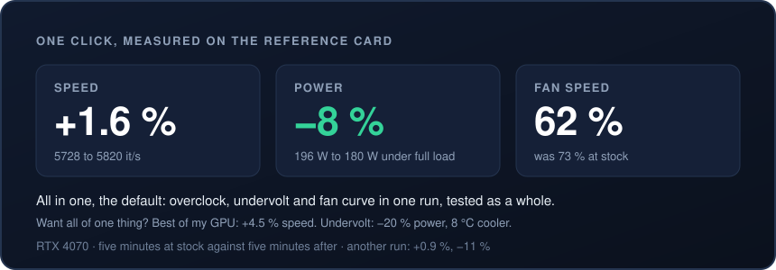
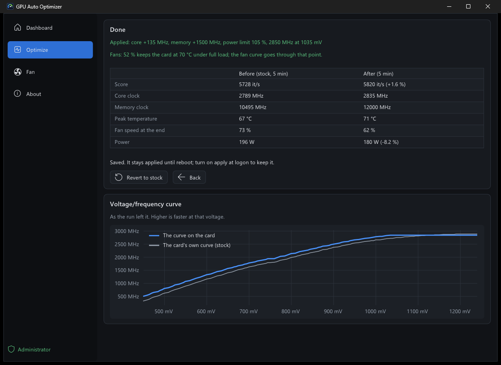
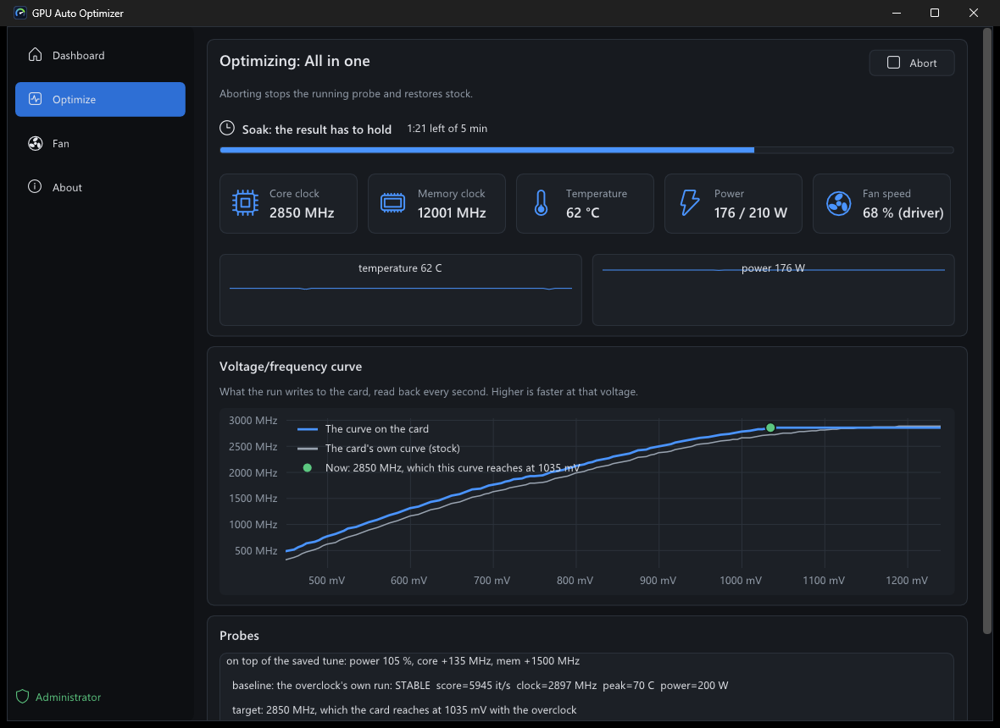
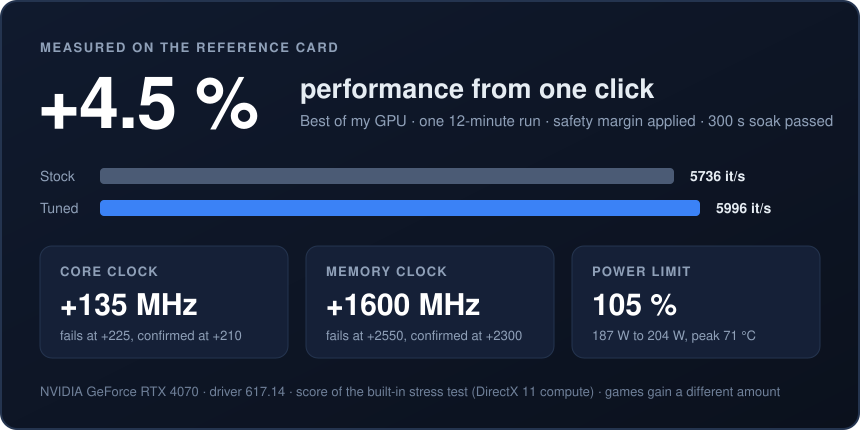
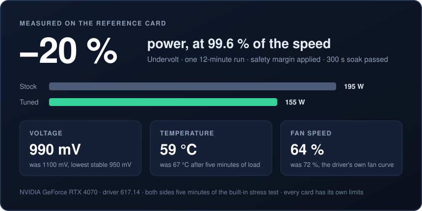
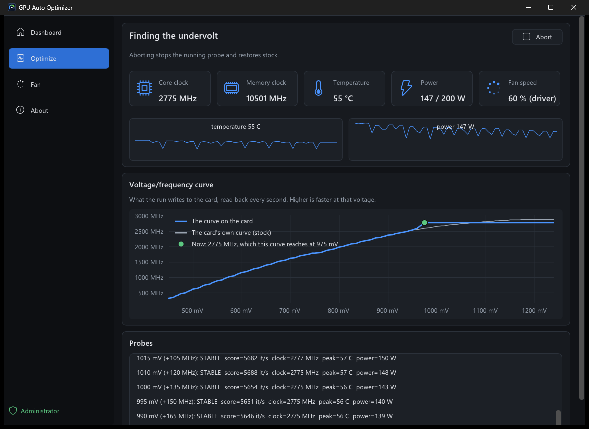
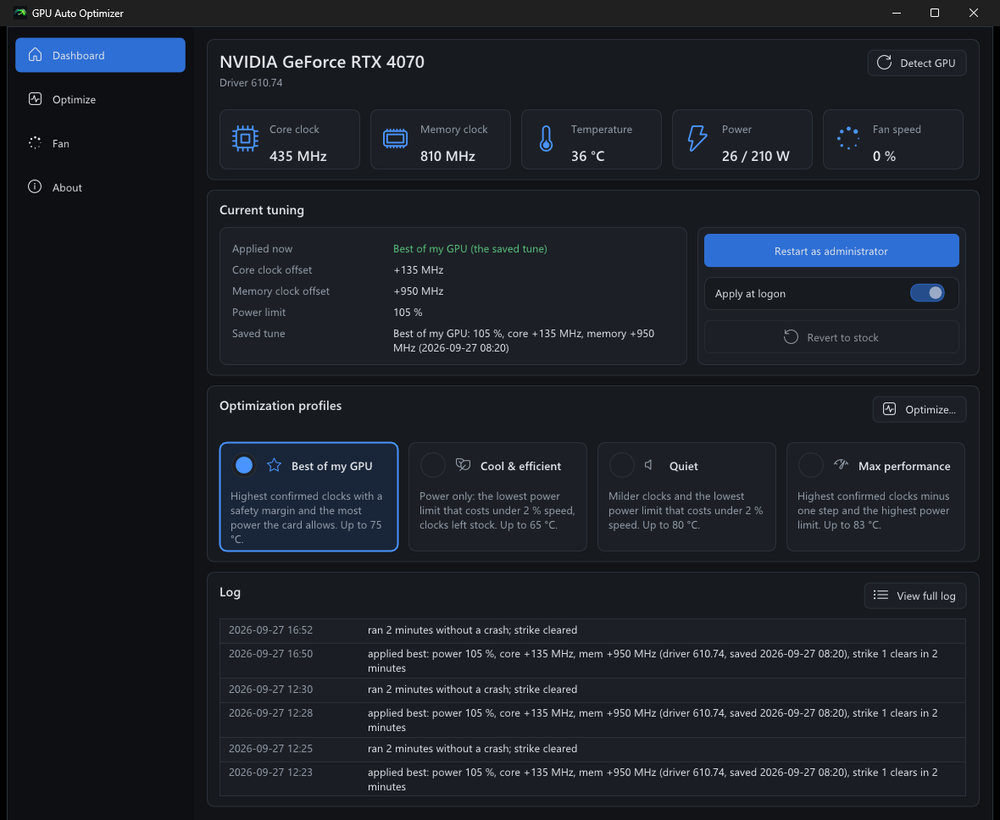

<div align="center">


# GPU Auto Optimizer

**Automatic overclocking and undervolting for NVIDIA GeForce cards on Windows.**<br>
Press one button. The app tests your card for about 40 minutes and finds settings that are a little faster, on less power,
with quieter fans. It then keeps them applied at every logon.

[](https://github.com/Rovey/gpu-auto-optimizer/releases/latest)
[](https://github.com/Rovey/gpu-auto-optimizer/actions/workflows/ci.yml)
[](LICENSE)


[**Download**](https://github.com/Rovey/gpu-auto-optimizer/releases/latest) · [Before you start](#before-you-start) · [Quick start](#quick-start) · [Does it support my card?](#does-it-support-my-card) · [Undo it](#undo-it) · [Report a problem](#problems-and-feedback) · [FAQ](#faq)



</div>

## What it does

- **Finds your card's own limits.** It raises the clocks step by step under a stress test that checks every result the card
  computes, then keeps a safety margin below the highest values that held.
- **Undervolts on top.** Your card reaches the same clock on less voltage, so it draws less power and runs cooler.
- **Tunes the fans.** It measures the slowest fan speed that still keeps the card cool enough.
- **Keeps it applied.** The result comes back at every logon. If the graphics driver resets, the tray app puts the tune back
  within half a minute.
- **Shows what you got.** You see your card at stock next to your card now: speed, power, temperature and fan speed, each
  measured for five minutes.

"Stock" means the card exactly as it came from the factory, with no tuning.

Free and open source (MIT). Two small native programs, under 2 MB together. No installer, no runtime, no driver and no
service.

## Before you start

> [!WARNING]
> A run finds your card's limit by going past it. That is how every automatic overclocker works.
>
> - **The screen can go black for a few seconds** when the graphics driver resets. That is expected. **Do not switch the
>   PC off**: the run recovers by itself.
> - **Save your work and close games first.** A driver reset also reaches other programs. Rarely, one of them crashes, or
>   Windows needs a sign-out or a restart afterwards.
> - **If the PC freezes,** the app remembers the setting it was testing and never tries it again.
> - **Abort run** stops a run at any time. The card goes back to stock, or to your saved tune if that was on before.
>
> Every value the app writes is read back and checked, and anything that fails ends at stock. Even so, every card has its
> own limits, and a stress test is not a game. Use it at your own risk (see the [MIT License](LICENSE)).

## Quick start

1. **Download** `GpuAutoOptimizer-<version>-win-x64.zip` from the [latest release](https://github.com/Rovey/gpu-auto-optimizer/releases/latest).
   It is under **Assets**. Do not download *Source code*.
2. **Unzip it** anywhere (right-click, **Extract all**).
3. **Start `GpuAutoOptimizer.exe`.** The app is not code-signed yet, so Windows SmartScreen may say "Windows protected your
   PC". Choose **More info**, then **Run anyway**. See [Is it safe to run?](#is-it-safe-to-run) if your antivirus complains.
4. **Close what would get in the way:**
   - [ ] Games, videos, and other programs that use the graphics card. Even an idle browser or editor can cost several
         percent of what the run measures.
   - [ ] MSI Afterburner and RivaTuner, including their icons in the notification area. A run does not start while they
         run.
   - [ ] In the NVIDIA app: **Automatic Tuning** off (System, Performance). A run does not start while it is on.
   - [ ] The NVIDIA overlay (Alt+Z) stays closed during the run.
5. **Open Optimize and press Optimize GPU.** **All in one** is already selected. You can pick another
   [profile](#profiles) first. Windows asks for administrator rights, because the app changes clocks and power limits.
6. **Wait.** The window draws what the run does and counts the long steps down. If other programs are still using the card,
   the run names them and asks: **Check again**, **Go on anyway** or **Don't start**. It closes nothing for you.
7. **Done.** The result is applied, saved, and applied again at every logon. Untick **Keep the result applied at every
   logon** before the run if you only want to try it: then the tune lasts until the next restart.

### How long a run takes

| Profile | Time, as the app estimates it |
|---|---|
| All in one (default) | About 40 minutes (31 on the reference card) |
| Best of my GPU, Cool & efficient, Quiet, Max performance | About 15 minutes |
| Undervolt | About 13 minutes |
| Test the tune after a driver update | 5 minutes |

The card is under full load all that time, and the fans get loud.

## Does it support my card?

| | |
|---|---|
| Windows | Windows 10 (version 1803 or later) or 11, 64-bit |
| Graphics card | NVIDIA, GTX 10-series (Pascal) or newer, with a current driver |
| Tested on | RTX 4070 (the reference card), RTX 5070 and RTX 3080 Ti. Other cards should work but have not been tested: [tell us how it went](#problems-and-feedback) |
| Laptops | Not tested yet: [tell us how it went](#problems-and-feedback) |
| NVIDIA cards per PC | **One.** With two or more NVIDIA cards, runs do not start (the window shows **Not started**), and nothing is applied at logon. An Intel or AMD integrated GPU next to one NVIDIA card is fine |
| Rights | Administrator rights to optimize or apply. Reading the card's sensors does not need them |

## Undo it

The settings the app writes are not permanent. The NVIDIA driver forgets them at every restart, and the app applies them
again at logon. To undo things, use these buttons in the window. They need administrator rights; the window offers
**Restart as administrator**.

| To | Do this |
|---|---|
| Put the card back at stock now | Dashboard, **Revert to stock** (also in the tray icon's menu). The saved tune stays saved. It is not applied again until you click **Apply saved tune**, or until the next logon while **Apply at logon** is on. |
| Give the fans back to the NVIDIA driver | Fan page, switch **Fan control** off, or **Exit** the app from the tray icon. The fans also go back to the driver on sleep, logoff and crashes. |
| Stop applying at logon | Dashboard, switch **Apply at logon** off. This removes the logon task, the Start menu entry and the copy in `C:\Program Files\GpuAutoOptimizer`. A copy that is still running is removed at the next restart. |
| Remove it completely | Do the three steps above, exit the app, and delete the folder you unzipped. To remove the saved tune and the logs too, delete `%ProgramData%\GpuAutoOptimizer` (needs administrator rights). Nothing else is installed. |

From an elevated command prompt: `gao --reset` (stock), `gao --fan auto` (fans to the driver), `gao --boot off` (no logon
apply).

## Problems and feedback

- **Something went wrong?** [Open a bug report](https://github.com/Rovey/gpu-auto-optimizer/issues/new/choose). Attach
  `run.log` and `boot.log` from `%ProgramData%\GpuAutoOptimizer`. `run.log` holds every line a run showed, written to disk
  as it happened, so it is still there after a crash. A run that was stopped or refused writes its `RESULT:` line there
  too.
- **Ran it on a card that is not listed above?** Share it with **Result on my card**, good or bad. The `RESULT:` line of
  `run.log` and the lines after it are all that is needed. Results from other cards show where the search works and where
  it does not.
- **Two NVIDIA cards in your PC?** The app does not support that yet. If you want to help make it work,
  [open an issue](https://github.com/Rovey/gpu-auto-optimizer/issues).

## What you get: results on the reference card

All numbers below come from the reference card, an RTX 4070, measured with the app's own stress test. Each column is five
minutes of full load, so the card is warmed through on both sides.

| | All in one (default) | Best of my GPU | Undervolt |
|---|---|---|---|
| Goal | A little faster on less power, quieter | All of the speed | All of the saving |
| Speed | **+1.6 %** | **+4.5 %** | −0.4 % |
| Power under load | **196 → 180 W (−8.2 %)** | 187 → 204 W | **195 → 155 W (−20.5 %)** |
| Fan speed under load | **73 → 62 %** | not recorded | 72 → 64 % |
| Temperature | 67 → 71 °C | not recorded | **67 → 59 °C** |
| Run time | about 35 minutes | 11.7 minutes | 12 minutes |

Why All in one gains less than either end: an overclock and an undervolt do not add up. An overclock moves the whole
voltage/frequency curve, so at every clock the card already runs on less voltage, and with the same safety margin there is
nothing left to take off. They are two ends of one line. All in one takes the middle, where the card beats stock on both
counts. **Best of my GPU** and **Undervolt** are the two ends.

> [!NOTE]
> Speed is the app's own stress test, a DirectX 11 compute load. Games gain a different amount, and every card has its own
> limits. Close other programs before a run: in one run, an emulator that used 11 % of the card cost 6 % of the score.

<details>
<summary><b>Words used here</b></summary>

- **Stock:** the card as it came from the factory, with no tuning.
- **Score (it/s):** iterations per second of the app's stress test. Higher is faster.
- **Offset:** how many MHz the app adds to the card's own core or memory clock.
- **Power limit:** the most power the card may draw, as a percentage of its default.
- **Voltage/frequency curve:** the table the card uses to pick a voltage for each clock. An undervolt reshapes it.
- **Probe:** a short stress test of one setting. **Soak:** the five-minute stress test the final result must pass.
- **Driver reset:** Windows restarts the graphics driver after the card stops responding. The screen goes black for a
  moment.

</details>

<details>
<summary><b>All in one: the full run</b></summary>

<div align="center">

</div>

| | Stock | After one click |
|---|---|---|
| Stress-test score | 5728 it/s | **5820 it/s (+1.6 %)** |
| Power under load | 196 W | **180 W (−8.2 %)** |
| Fan speed at the end | 73 % | **62 %** |
| Peak temperature | 67 °C | 71 °C |
| Core clock under load | 2789 MHz | 2835 MHz |
| Memory clock under load | 10495 MHz | 12000 MHz |

The card is a little faster, on 8 % less power, with slower fans. It runs a few degrees warmer because the fans are
allowed to: the fan tune aims for 70 °C, 5 °C under the profile's limit, and found that 52 % holds it.

Another run gave 0.9 % more score on 10.8 % less power with the fans at 55 %. The memory offset a run finds differs from
run to run on this card; the score barely moves with it.

In an earlier run, an emulator that used 11 % of the card cost 6 % of the score. The run now says so when its final test
does not match the step before it. The logs are in [docs/hardware-checks.md](docs/hardware-checks.md) (checks 75, 76 and
94).

<div align="center">

</div>

</details>

<details>
<summary><b>Best of my GPU: the full run (+4.5 %)</b></summary>

<div align="center">

</div>

| | Stock | After one click |
|---|---|---|
| Stress-test score | 5736 it/s | **5996 it/s (+4.5 %)** |
| Core clock under load | 2766 MHz | 2899 MHz (offset +135 MHz) |
| Memory clock under load | 10355 MHz | 12100 MHz (offset +1600 MHz) |
| Power under load | 187 W | 204 W (power limit 105 %) |

The search raised each clock until the card computed a wrong value (core +225 MHz, memory +2550 MHz). It confirmed the last
values that held (+210 and +2300 MHz) and applied them minus a safety margin. The result then had to pass a five-minute
soak before it was saved. The whole run took 11.7 minutes. The log of this run is in
[docs/hardware-checks.md](docs/hardware-checks.md) (check 52, fourth run).

</details>

<details>
<summary><b>Undervolt: the full run (−20 % power)</b></summary>

<div align="center">

</div>

Clocks and power limit stay stock. The card reaches the same clock on less voltage.

| | Stock | After one click |
|---|---|---|
| Power under load | 195 W | **155 W (−20.5 %)** |
| Temperature | 67 °C | 59 °C |
| Fan speed | 72 % | 64 % |
| Stress-test score | 5732 it/s | 5708 it/s (−0.4 %) |
| Core clock under load | 2788 MHz | 2778 MHz |
| Voltage the card reaches that clock at | 1100 mV | 990 mV |

In this run the fans were left to the NVIDIA driver's own curve. The search now keeps them on the fan curve in use. The
search lowered the voltage one curve point at a time until the card computed a wrong value (940 mV). It confirmed the lowest
value that held for 30 s (950 mV) and applied it with the safety margin (990 mV). The result then had to pass the
five-minute soak before it was saved. The whole run took 12 minutes. The log of this run is in
[docs/hardware-checks.md](docs/hardware-checks.md) (check 72).

<div align="center">

</div>

</details>

<div align="center">

</div>

## Profiles

**All in one** is the default. Pick another one when you want one thing only.

| Profile | Goal | Temperature limit | Tunes |
|---|---|---|---|
| **All in one** (default) | More speed than stock on less power: the overclock below, an undervolt on top of it at a clock half-way back to stock, and the quietest fan curve that holds the temperature | 75 °C | power, core, memory, the voltage/frequency curve, fans |
| **Best of my GPU** | Highest confirmed clocks with a safety margin, most power the card allows | 75 °C | power, core, memory |
| **Cool & efficient** | Lowest power limit that costs under 2 % speed; clocks stay stock | 65 °C | power |
| **Quiet** | Milder clocks and the lowest power limit that costs under 2 % speed | 80 °C | power, core, memory |
| **Max performance** | Highest confirmed clocks minus one step, highest power limit | 83 °C | power, core, memory |
| **Undervolt** | The clock the card runs under load at stock, on the lowest stable voltage plus the same margin; clocks and power limit stay stock | 75 °C, or what the card reached at stock if that was more (see below) | the voltage/frequency curve |

- **Safety margin:** the search finds the highest stable offset and applies a fraction of it (70 % for Best of my GPU),
  always at least one step below the edge.
- **Best of my GPU and Max performance promise speed,** so they keep a result only when it is at least as fast as the card
  was at stock (within 1 %, the scatter of two five-minute runs). A card that runs warmer at stock than the profile allows
  has to have its power limit lowered to meet the temperature, and that can cost more than the clocks win back. The run then
  says so, saves nothing, and leaves the card at stock. **Undervolt** is the profile for such a card. Quiet and Cool &
  efficient give a little speed away on purpose and are not judged this way.
- **Undervolt on a hot card:** when the card ran hotter than 75 °C at stock, the run uses that temperature as its limit
  instead. It goes no higher than the card's own temperature target, or 85 °C when the card reports none. The fan curve
  moves up by the same amount, so the fans do not run at full speed to reach a temperature the card never had.
- **The Undervolt profile replaces a saved overclock.** On the card, a core offset and the curve are one table. All in one
  saves both as one shape, and so does `gao --undervolt --on-overclock`.
- **The card's built-in curve moves with temperature,** so the points above the one the card runs on are stored a little
  lower than it. A warm card then gives up one 15 MHz clock step instead of going to a higher voltage, which had cost about
  12 W.

## What protects your card

- **Verified, not trusted.** Every value written to the driver is read back and checked. A failed apply ends at stock.
- **A crash is remembered.** A journal on disk records each setting before it is tried, so a setting that froze the machine
  is never tried again.
- **It gives up before you have to.** Three logons in a row that crash switch apply-at-logon off. Four driver resets within
  an hour with the tune applied put the card back at stock.
- **It plays fair.** If MSI Afterburner or another tool changes the settings, the app steps aside instead of fighting over
  them.
- **A driver update means a retest.** A tune belongs to the driver it was tested on. After an update the app does not apply
  it, says so, and offers **Test the tune (5 min)**. That takes five minutes, not a whole new run.

What it cannot do: promise that every card stays stable in every game, or keep a driver reset from reaching other programs
(see [Before you start](#before-you-start)).

## More features

- **You see what it does.** During a run the window draws the card's voltage/frequency curve as the run writes it, over the
  card's own curve. It says which step the run is at and counts every long step down.
- **You keep seeing what it gave.** The dashboard shows the saved tune against the card at stock, as measured when the tune
  was made: speed, power, fan speed under load and peak temperature.
- **Fan curves:** the measured one, Silent, Normal, Cool or Aggressive, or your own. The fans stop at idle without cycling
  on and off. The app learns the lowest speed your fans can actually hold. The fans go back to the driver on exit, sleep,
  logoff and crashes.
- **Updates in one click.** When a new version is out, the window shows **Update available** at the bottom left.

## FAQ

<details id="is-it-safe-to-run">
<summary><b>Is it safe to run? Why does Windows or my antivirus warn?</b></summary>

The executables are not code-signed yet, so SmartScreen does not know them. Choose **More info**, then **Run anyway**. The
app also restarts itself with administrator rights, copies itself to Program Files and registers a logon task. Some antivirus
programs treat that combination in an unknown program as suspicious, so one may warn or remove it. The source code is
public, and every release is built by GitHub Actions from this repository. To check that your download is the one GitHub
built:

```powershell
(Get-FileHash .\GpuAutoOptimizer-<version>-win-x64.zip -Algorithm SHA256).Hash   # compare with the .sha256 file of the release
gh attestation verify .\GpuAutoOptimizer-<version>-win-x64.zip --repo Rovey/gpu-auto-optimizer   # optional, needs the GitHub CLI
```

</details>

<details>
<summary><b>The run reset the driver or failed a probe. Is that normal?</b></summary>

Yes. The edge of a card is found by crossing it. A probe that computes a wrong value ends in `WRONG RESULT`, and the search
keeps the last value that passed. A probe that ends in `DEVICE LOST`, `STALLED` or `NO TELEMETRY` is treated as a driver
reset.

A search may reset the driver once. The screen goes black for a moment. The run then reconnects, sets the card to stock,
rests for 20 seconds, checks that the card computes normally again, and stops exploring that clock. It tries no new values
for that clock, and confirms a little below the last value that passed. The memory search and the core search each get one
reset, so a run can reset the driver twice. One more ends the run at stock with nothing saved, and so does a card that does
not come back. Nothing about a reset is remembered, so the next run on such a card crosses the edge again. Results on real
cards are in [docs/hardware-checks.md](docs/hardware-checks.md), checks 51 and 52.

A driver reset also reaches the other programs on the desktop. On an RTX 5070, one run with the app's window open left a
desktop where only that window was drawn, and one other program crashed; the owner had to sign out and in. A second run,
with the window closed, left the desktop usable. The window is now drawn by the processor instead of the graphics card.
Whether that is enough on every card is not known. When it happens, the app says so: sign out and in, or restart the
computer. Save your work before a run.

If the machine freezes instead, the crash journal makes sure the next run stays below that setting.
</details>

<details>
<summary><b>What if a setting crashes my PC?</b></summary>

During a search, the crash journal makes sure that setting is never tried again, and the next run stays below it. At logon,
three crashes in a row within two minutes of applying switch apply-at-logon off.
</details>

<details>
<summary><b>Does it work alongside MSI Afterburner or the NVIDIA app?</b></summary>

Not during a run. A run does not start while MSI Afterburner or RivaTuner Statistics Server (`MSIAfterburner.exe`,
`RTSS.exe`) is running, and says which one to close. Close it completely, including its icon in the notification area, and
switch off its start with Windows if it applies settings there. Outside a run they can coexist as long as only one of them
applies settings. If Afterburner applies an offset while GPU Auto Optimizer keeps its tune applied, the watchdog notices,
says so in a notification and leaves the settings alone.

Programs that merely use the card (a browser, an editor, a video) are a different matter. They change nothing on it, so a
run is not refused next to them. The run names them and asks, because they make everything it measures lower and less
steady. On the command line it stops with that list; add `--busy-ok` as the last argument to go on anyway.

The NVIDIA app can stay installed. Two of its features get in the way of a run. **Automatic Tuning** (System, Performance)
applies an overclock of its own and scans again from time to time, so switch it off, both for a run and for as long as you
keep a tune of this app applied. The **overlay** (Alt+Z) draws on programs that use the card, so keep it closed while a run
is going. A run does not start while Automatic Tuning is on, and `gao --status` shows what the app reads
(`nvidia app: Automatic Tuning off`). The app cannot see the overlay, so keeping that closed is up to you.
</details>

<details>
<summary><b>What happens after a driver update?</b></summary>

The saved tune is tied to the driver version it was tuned on, because a new driver can change what is stable. After an
update it is not applied. The app says so at logon, and the dashboard shows **Test the tune (5 min)**. That loads the card
for five minutes with the tune on it. If it holds, the tune is applied again and belongs to the new driver. If it does not,
the card goes back to stock and you optimize again. The test never starts by itself. On the command line: `gao --retest`.
</details>

<details>
<summary><b>Does it undervolt? Can I have an overclock and an undervolt together?</b></summary>

Yes. The **Undervolt** profile reshapes the voltage/frequency curve so that the card reaches its stock clock at a lower
voltage, and nothing above it runs faster. It does not lock a voltage: that froze the reference card during development.
It is found, tested and kept applied like an overclock. On its own, it replaces a saved overclock.

**All in one** gives you both as one shape: the overclock, with an undervolt on top at a clock half-way back to stock.
`gao --undervolt --on-overclock` does the same on top of a saved overclock.
</details>

<details>
<summary><b>Can it control the fans?</b></summary>

Yes. Each profile comes with a fan curve, and you can pick another one (Silent, Normal, Cool, Aggressive) for a run or
afterwards. On the Fan page you can edit it: drag the points, and choose a temperature below which the fans stop once the
card is cool and idle. The NVIDIA driver controls the fans there, so a crash or a killed app can never leave them stopped. A
run uses the profile's curve, so the tune is tested at the temperatures that curve produces. Choosing a quieter curve
afterwards shows a warning. The curve runs while the tray app runs with administrator rights. Otherwise the driver controls
the fans.
</details>

<details>
<summary><b>Does it connect to the internet?</b></summary>

Only to look for a new version: one request to `api.github.com` when the app starts, and once a day after that. Nothing is
sent but the request itself. You can switch it off under **About**. An update is downloaded only when you click **Update
available** (or run `gao --update`). The zip comes from this project's GitHub releases over HTTPS and is installed only when
its SHA-256 matches the one GitHub publishes for it.
</details>

<details>
<summary><b>How do I move to a new version?</b></summary>

From 0.3.1 on, click **Update available** at the bottom left of the window. From an older version, download the zip and
start `GpuAutoOptimizer.exe` from it. It offers to replace the older copy that runs in the tray, and then updates the copy
that starts at logon.
</details>

<details>
<summary><b>Where does it keep its data?</b></summary>

In `%ProgramData%\GpuAutoOptimizer`:

- `gao.json`: the saved tune.
- `journal.jsonl`: the crash journal.
- `boot.log`: what happened at logon.
- `run.log`: every line a run showed, written as it happened, so that it is still there after a crash. Send it along with a
  problem report.

A run begins by measuring the card at stock. That part of the log also records what the card did meanwhile: its own
temperature target, and a line every ten seconds with the clock, the temperature, the power and the fan speed. Users can
read the folder. Only administrators can write to it, because the logon task runs with administrator rights.

Turning **Apply at logon** on copies the app to `%ProgramFiles%\GpuAutoOptimizer\` and starts it in the tray at logon, so
the unzipped folder can be deleted afterwards.
</details>

## How it works

<details>
<summary><b>The search, step by step</b></summary>

```mermaid
flowchart LR
    S[Stock<br/>300 s: the "before",<br/>and what probes are judged by] --> B[Power limit]
    B --> C[Memory offset<br/>bandwidth peak, confirmed,<br/>safety margin]
    C --> D[Core offset<br/>single steps, confirmed,<br/>safety margin]
    D --> G[Soak<br/>300 s]
    G --> H[Save profile]
```

- **Every run starts with the card at stock for five minutes,** as long as the result is tested at the end, with the fans
  left to the NVIDIA driver. That is the "before" of the result. A card is not heated through after 30 s, so a shorter
  measurement would make every result look warmer and louder than stock. Some cards get hot there, because the driver's own
  fan control lets them (a 3080 Ti reached 85 °C with its fans at 65 %). The measurement stops at 85 °C, what it measured
  until then is the "before", and the run goes on. From there every step keeps the fans on a curve that reaches 100 % at the
  run's temperature limit.
- **Stress test.** A DirectX 11 compute load in which the GPU checks every value it computes against a known answer. Each
  probe ends in a verdict: `STABLE`, `WRONG RESULT`, `DEVICE LOST`, `STALLED` (the values were right but the card computed
  almost nothing), `TOO HOT` or `NO TELEMETRY`.
- **Memory comes first and stops at the bandwidth peak,** not at the first error. GDDR6 and GDDR6X retry failed transfers,
  so an overclocked memory bus loses speed long before it returns a wrong result. The search raises the offset 50 MHz at a
  time and measures bandwidth at each step, until a step fails or has clearly lost bandwidth. It then measures again from
  200 MHz below that point down, and keeps the lowest offset within 1 % of the best. Where the memory gave out is remembered
  for that card and driver, so a later run stays below it without going there again. Where bandwidth cannot be measured, the
  memory is left at stock: without that measurement nothing says where to stop, and the first wrong result comes far too
  late.
- **The core search climbs from stock.** With the chosen memory offset applied, it raises the core offset 15 MHz at a time
  until a probe fails, and keeps the last value that passed. How far it may go comes from the range the driver reports for
  your card, so a card that can hold more is not stopped at a fixed limit.
- **Each edge is confirmed.** The value a search ends on gets a 30 s probe, and a lower value is tried if it does not hold.
  The safety margin is applied to the confirmed value, and the result as a whole must pass the 300 s soak.
- **A driver reset ends that clock's search.** When a search pushes a card past its edge, the driver can reset: the screen
  goes black for a moment. The run then reconnects to the driver, sets the card to stock, leaves it without load for
  20 seconds and checks with a short probe at stock that it computes normally again. After that the search tries no new
  values for that clock: it keeps the last value that passed and confirms four steps below it. Each clock has its own
  search, so a reset in the memory search does not keep the core from being searched; a run can therefore reset the driver
  twice, once per clock. One reset more than that ends the run at stock with nothing saved, and so does a card that does not
  come back. Results on real cards are in [docs/hardware-checks.md](docs/hardware-checks.md), checks 51 and 52.
- **The undervolt search descends.** It measures the card at stock for five minutes, as long as the result is soaked later,
  so that the two compare: the clock it runs under load, and where on its voltage/frequency curve that clock sits. Then it
  raises a point one step lower on the curve to that clock, keeps every point above it below that so the card has no reason
  to ask for more voltage, and tests that. Then it tries the next point down, until one fails. The lowest point that passed
  gets the 30 s probe, the margin is applied to how far that point was raised, and the result must pass the 300 s soak. No
  voltage is locked and the points below stay as they are, so idle clocks do not change.
- **All in one runs the others in a row:** five minutes at stock to compare with; the overclock of Best of my GPU; an
  undervolt on top of it; the fan tune; five minutes with everything applied. An overclock and an undervolt do not add up
  (on the reference card the undervolt on top of a full overclock saved 5 W of 201), so All in one takes the middle: a clock
  half-way between stock and the overclock, on the lowest voltage the margin allows for it. The fan tune then sets the fans
  by hand under that load, lets the temperature settle, and lowers the speed 5 % at a time until the card gets warmer than
  5 °C under its limit. The lowest speed that held becomes a point of the fan curve.
- **Crash journal.** Before a candidate touches the hardware, a `begin` line is flushed to disk. If the machine freezes, the
  unmatched `begin` becomes a ceiling the next run stays below.
- **Apply at logon.** A scheduled task starts the app in the tray at logon, and the app applies the saved profile. It
  refuses when the driver version or the card changed since tuning, or when the PC has more than one NVIDIA GPU. It stops
  after three logons in a row that crashed within two minutes.
- **Tune watchdog.** Every 30 seconds the tray app reads back what the driver reports. It re-applies the tune after a reset,
  and backs off when another program changed the settings. Four resets within an hour, of the tune or of the driver with
  the tune applied, are a sign the tune is not stable: the card is set to stock and the tune is no longer re-applied.

</details>

## Command line

`gao.exe` ships next to the app and drives the same engine. Commands that write to the GPU need an elevated shell.
`gao --help` lists every command, including the test tools not shown here.

| Command | What it does |
|---|---|
| `gao --optimize best\|quiet\|cool\|max [--fan-curve silent\|normal\|cool\|aggressive]` | Runs the search; exit code 0 when saved, 2 when applied but not saved |
| `gao --optimize all` | All in one: stock measured, overclock, undervolt on top, fan tune, final test; about 40 minutes |
| `gao --undervolt` | Runs the undervolt search; saved like `--optimize`, in place of a saved overclock |
| `gao --undervolt --on-overclock` | The undervolt searched on top of the saved overclock and saved into it |
| `gao --retest` | After a driver update: the saved tune under full load for five minutes; kept for the new driver when stable, stock when not |
| `gao --apply` | Re-applies the saved profile |
| `gao --reset` | Returns to stock clocks and the default power limit |
| `gao --boot on\|off` | Turns apply-at-logon on or off |
| `gao --fan auto` | Hands every fan back to the NVIDIA driver, whatever set it (a running tray app takes them again on its next tick; switch Fan control off to keep the driver in charge) |
| `gao --status` | Saved profile, what is applied now, apply-at-logon state |
| `gao --version` | The app's version |
| `gao --probe` | Live sensor readings: clocks, temperature, fan, power, clock-offset ranges |
| `gao --curve` | Prints the voltage/frequency curve as the driver reports it; changes nothing |
| `gao --stress <seconds>` | Runs the stress test alone and prints its verdict; changes nothing |
| `gao --stress <seconds> --duty <pct>` | A light load instead: the card works that share of the time and idles in between, for checking the fans' idle rule; changes nothing |
| `gao --bandwidth [--after-load <sec>]` | Measures the current memory bandwidth and shows every run of the measurement; with `--after-load`, right after that many seconds of the stress load, as a run measures it |
| `gao --busy` | Shows the other programs that use the card right now, as a run looks for them before it starts; changes nothing |
| `gao --update` | Installs the latest release into the folder `gao.exe` is in, if there is a newer one |
| `gao --stress-recreate` | Runs the stress test, rebuilds its GPU device, runs it again; prints both scores and the rebuild time; changes nothing |

A run (`--optimize`, `--undervolt`, `--retest`) does not start next to other programs that use the card; add `--busy-ok` as
the last argument to go on anyway. Ctrl+C during `--optimize` restores stock.

## Building from source

Visual Studio 2026 with the C++ and CMake components. From a Developer PowerShell in the repository root:

```powershell
cmake --workflow --preset ci    # configure, build Release, run the tests
```

This produces `build\Release\GpuAutoOptimizer.exe` and `build\Release\gao.exe`. See
[docs/development.md](docs/development.md) for the code layout, the test setup and the hardware checklist.

## License

[MIT](LICENSE) © Rovey. The executables contain Dear ImGui and JSON for Modern C++, both under the MIT License; their
notices are in [THIRD-PARTY-NOTICES.md](THIRD-PARTY-NOTICES.md) and in every release zip.
