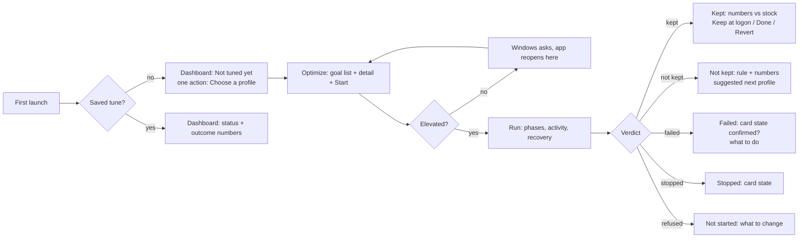
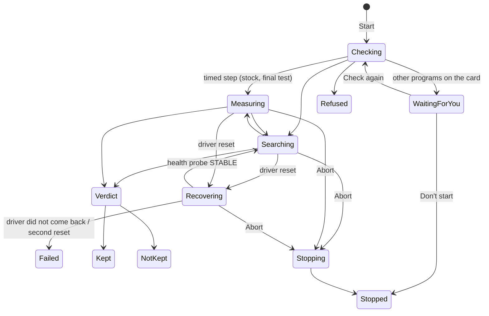

# UX redesign proposal: GPU Auto Optimizer window

Status: **design approved (revision 5, 2026-11-17); design phase complete. Nothing in it is built.**
Written 2026-11-17 against `main` at b49d43d (the code of 0.4.10-rc3).
The release work for 0.4.10 stays separate; this redesign starts after 0.4.10.

Revision 2 (same day), visual language only; the functional decisions D1–D13 and the roadmap are
unchanged:

- No banners and no coloured stripes, outlines or tinted backgrounds for states. Semantic colour appears
  only in small status icons (a filled circle with a glyph); type, spacing and grouping carry the
  hierarchy (sections 5 and 6.7).
- One card per screen, for the thing the screen is about; context and details sit on the page around it
  (section 6.11). The Dashboard is regrouped into the card now, your tune (status, what it achieved,
  settings and controls in one card) and recent activity (section 7.2); the profile list, its detail and
  Start are one card (section 7.3).
- Abort run is a secondary button; the selected nav item has no accent bar; selected rows use a neutral
  fill.
- All four mockups redrawn to match.

Revision 3 (same day), layout geometry only; D1–D13, the roadmap and the visual language of revision 2
are unchanged:

- Every screen sits on a declared grid: the page on 5 × 160 px, a card's content on 12 × 46 px, the
  Optimize card on 8 × 85 px, a result on a 2 × 420 px text column (section 6.3). Every horizontal
  edge in the four mockups is a line of its screen's grids or a fixed offset of a component, and a
  check confirms it (section 6.12).
- Repeated components have one geometry: buttons 186 or 89 px wide and 36 or 48 px high, the readings
  row, the collapsible-section row, the 24 px item lead, the 32 px status-icon lead (section 6.3).
- The Dashboard's controls sit in the columns of the settings above them; the readings of the run screen
  moved out of the activity card onto the page, identical to the Dashboard's (sections 7.2 and 7.4).

Revision 4 (same day), cohesion: the four screens as one product. D1–D13, the roadmap and the grids of
revision 3 are unchanged; nothing is added that the engine does not already know.

- **Sidebar:** a small product mark beside the name on the page title's line; nav icons in one column
  (centre x 36) and every nav text at x 56; the bottom area says what the app may do on this PC
  ("Administrator · Can tune the card") under a hairline, instead of a lone word (section 7.1).
- **One mark family for every sequence:** recent events and recovery steps are timelines with the same
  14 px marks and a joining hairline (section 6.5).
- **The live readings are one strip,** hairlines between its five cells, the same on the Dashboard and
  the run screen (section 6.11).
- **Dashboard:** four outcomes measured against stock, then, under a hairline, two groups that do not
  share the outcomes' columns: the active settings as a list and the tune step as one control group that
  says what it lowers. A trade-off reads as one (the temperature: "+4 °C warmer", dimmer, with the reason
  under it). Optimize again beside the status, Revert to stock beside Apply at logon as the card's last
  row; Recent activity as a timeline without hairlines (section 7.2).
- **Optimize:** 32 px between the divider and the detail, which answers five questions in a fixed order
  with one sentence and four facts; the logon switch before its label, as on the Dashboard (section 7.3).
- **Run:** the reset is named as something that can happen while a run looks for the limit, not as
  expected, and the sentence says the run reconnects and checks the card before continuing; "Your part"
  first; the recovery steps joined as a timeline; the curve drawn in `text-2` so it
  does not compete with the state (section 7.4).
- **Result:** measured values right-aligned, an empty unit between what was measured and the rule, the
  percentage in the outcome; the next step says what Undervolt aims for and that only its own run shows
  whether it gains; a verdict for a run that could not be compared (section 7.5).
- **A one-page specification** of the system (section 6.13).

Revision 5 (same day), final pass, approved by the product owner: on the Dashboard the outcomes and the
settings no longer share columns (an outcome does not belong to the setting under it); a trade-off reads
as one ("+4 °C warmer", dimmer, with its reason); the tune step is one group that says what it lowers
(the undervolt and the core and memory offsets, not the power limit, as `at_step` does) and shows +5 %
disabled at step 0; the recovery sentence says a reset can happen while a run looks for the limit and
that the run checks the card before continuing (sections 6.8 and 7.2).

Supporting material in this folder:

- `current/`: pictures of the window as it is now, taken from `GpuAutoOptimizer.exe --demo` (a played
  run: no card is touched, the numbers are made up by the demo).
- `mockups/`: four proposed screens as SVG, drawn with the tokens and grids of section 6.
  `generate_mockups.py <folder>` redraws them; it needs Pillow and the Windows fonts Segoe UI and
  Segoe UI Semibold, because it measures every text and stops when one does not fit its column. Where a
  mockup quotes a run, the caption names the logged run it comes from; live sensor values in the
  mockups are illustrative. `gridcheck.py` checks the drawn SVGs against the grids of section 6.3
  (standard library only).

The seven principles this proposal applies (from "How to Make AI-Generated UI Look Expensive (7 Fixes)"):
one focal point per screen, a spacing system, typographic hierarchy, a restrained palette, real content,
consistent details, and motion that follows the user's action.

---

## 1. Executive summary

The window is honest, careful and complete: every state the engine knows is shown somewhere, nothing is
hidden, and the copy avoids promises. Its weakness is not what it says but how it is arranged. Every
screen gives the same visual weight to the one thing the user must know and to ten things they might
want to know, and the moments where trust is decided (a driver reset during a run, a result that is not
kept) look like ordinary progress or like an error.

The proposal keeps the framework (Dear ImGui), the four pages, the engine and every number the window
shows today. It changes four things:

1. **A state for every moment of a run.** The run screen says which phase is running, shows a driver
   reset as a recovery with only the facts the engine confirmed, and keeps technical detail one click
   away instead of always open.
2. **The verdict first on every result.** Kept, not kept (a rule decided), failed, stopped, refused: each
   has its own look and says what decided it, with the numbers.
3. **A goal-first profile choice.** Six profiles in one list with a one-line goal each, and one detail
   panel for the selected profile with what it takes, what it changes and the single Start button.
4. **A small design system.** One spacing scale, five text sizes, one accent with a fixed set of roles,
   three button variants and a handful of components, defined once in `theme.hpp`. Colour is used
   functionally: semantic colours only in small status icons, never as backgrounds, borders or stripes.
   Each screen has one card for what it is about, and related information sits next to the action it
   informs.

Two of the improvements need data the window does not get today (which phase a run is in, and the
numbers of a result that was not kept). Both are additions to what the engine reports, not changes to
what it does; they are listed apart in section 11.

---

## 2. Current state: inventory

### 2.1 Architecture as it affects the UI

- **Two executables, one engine.** `gao.exe` (CLI) and `GpuAutoOptimizer.exe` (window, tray, watchdog)
  share `src/app/common*`. The window adds no tuning logic of its own: it starts runs through
  `OptimizeWorker` (`src/app/gui/worker.*`) and reads a `Snapshot` (log lines, the current timed step and
  its length, the outcome structs) about every frame.
- **Dear ImGui, immediate mode, DX11 backend** (`main_gui.cpp`). Pages are functions (`ui_*.cpp`) that
  redraw from `UiState` every frame. Colours are nine `ImVec4` constants in `ui_widgets.hpp`; sizes are
  multiples of `em()` (the font size, 17 px at 96 DPI) written at each call site.
- **Frames on demand.** The loop draws nothing while hidden, about 4 frames a second when idle, 10 during
  a run, 30 during a timed countdown, and a few frames after input. A CPU-drawn fallback (`soft_render`)
  caps at 20. Reason, from the code: "The tool measures the GPU; its own window must not load it." Any
  motion design has to live inside this budget (section 6.10).
- **Fonts:** Segoe UI regular and semibold, 17 px, with Segoe Fluent Icons (Segoe MDL2 on Windows 10)
  merged in. The fan icon is drawn by hand because the icon fonts have none.
- **Window:** minimum 1000 x 700 px at 100 % scaling, dark title bar, DPI changes handled.

### 2.2 Screens and windows

| # | Screen | File | What it holds |
|---|---|---|---|
| S1 | Shell | `ui.cpp` | Sidebar: Dashboard, Optimize, Fan, About; an update line; "Administrator" / "Not administrator" at the bottom |
| S2 | Dashboard | `ui_dashboard.cpp` | GPU card (name, driver, icon-only "detect again" button, five telemetry tiles); "Your tune" card (a table of up to ~14 rows beside a column of up to six controls); Log card (3 lines, or all) |
| S3 | Optimize: Choose | `ui_optimize.cpp` | All in one card (full width), four profile cards, Undervolt card (full width), fan curve during the run (radio + four presets), Start button, duration, five paragraphs of warnings, "Keep the result applied at every logon" |
| S4 | Optimize: Run | `ui_optimize.cpp` | Title, "N of about M min", Abort run, a warning paragraph, the question about other programs (when asked), the timed step with countdown bar, five tiles, two sparklines, the V/F curve card, the Details log |
| S5 | Optimize: Results | `ui_results.cpp` | Five result layouts (optimize, undervolt, all in one, retest, no result) with headings "Done: …", "The tune holds", "Not applied", "Not started", "Stopped"; comparison table; saved/not saved line; reset note; Done / Apply at every logon / Revert to stock / Back; curve card |
| S6 | Fan | `ui_fan.cpp` | Fan control switch and mode, drag-point curve editor, stop-below slider, add/remove point, back to the tested curve, four presets, warnings and a legend paragraph |
| S7 | About | `ui_about.cpp` | Name, version, one paragraph, paths, update-check switch |
| S8 | Tray | `main_gui.cpp` | Icon with tooltip; menu: Open, Re-apply saved tune, Lower/Raise tune 5 %, Revert to stock, Exit; about a dozen balloon messages |
| S9 | Native dialogs | `main_gui.cpp` | Exit during a run (MessageBox, Yes/No), restart as administrator, demo refusals |

### 2.3 Components in use

`begin_card`/`end_card` (panel), `tile` (icon + label + value), `primary_button`, plain `ImGui::Button`,
`toggle` (hand-drawn switch), `Checkbox`, `RadioButton`, `preset_card` with `icon_badge`, `tuning_row`
(label/value table), `comparison` (before/after table), `ProgressBar` (countdown), `PlotLines`
(sparkline), `curve_card` (V/F chart), `curve_editor` (fan curve), the log table, `nav_item`,
`update_line`, tooltips, and text helpers `heading`, `text_bold`, `dim`, `wrapped(colour, …)`.

### 2.4 User journeys

| ID | Journey | Path today |
|---|---|---|
| J1 | First launch, not elevated | Dashboard: GPU, live tiles, "Saved tune: None yet. Pick a profile and optimize.", blue "Optimize GPU..." |
| J2 | First optimize | Optimize page, pick a profile, Start; without rights Windows asks, the elevated copy reopens on Optimize with the profile kept |
| J3 | Other programs on the card | Run screen asks: Check again / Go on anyway / Don't start |
| J4 | A run, normal | Step name, countdown for timed steps, "N of about M min", tiles, sparklines, curve, Details |
| J5 | A driver reset during a run | The step label changes to "The driver was reset: resting before the card is loaded again", then "Checking that the card is back"; the rest of the screen is unchanged |
| J6 | Result kept | "Done: x % faster, y % more power", Applied line in green, table, "Saved…", Apply at every logon / Done / Revert to stock |
| J7 | Result not kept, failed or refused | "Not applied" or "Not started", the engine's reason in red, "Nothing was saved…" |
| J8 | Abort | "Stopping and putting the card back...", then "Stopped" with what happened to the card |
| J9 | Driver updated | Balloon; Dashboard warning row; primary button becomes "Test the tune (5 min)"; retest result "The tune holds" or "Not applied" |
| J10 | Another program changed the settings | Balloon; Dashboard "Applied now: Set by another program" in amber with a hint |
| J11 | A game crashes on the tune | Dashboard −5 % / +5 %, "Test this step (5 min)"; tray Lower/Raise tune |
| J12 | Fan curve | Fan page editor, presets, warning when quieter than the tested curve |
| J13 | Update | Sidebar line "Update available", click installs and restarts |
| J14 | Logon apply and strikes | boot.log lines on the Dashboard log; "Crashes after logon: n of 3" |
| J15 | Watchdog: 4 resets in an hour | Balloon; the tune is no longer re-applied |
| J16 | Refusals | More than one NVIDIA GPU, MSI Afterburner open, NVIDIA Automatic Tuning on: "Not started" with the reason |
| J17 | Exit from the tray during a run | Native Yes/No question, one at a time (#85) |

### 2.5 Important user decisions

1. Which profile (six choices, plus the fan curve during the run for four of them).
2. Whether to go on while other programs use the card.
3. Whether to keep the result applied at every logon.
4. Whether to abort a run.
5. After a result: keep it, revert to stock, or lower it in 5 % steps.
6. After a driver update: test the tune (5 min) or optimize again.
7. Fan control on/off and the curve's shape.
8. Whether to install an update.

### 2.6 Technical information shown

Live: core and memory clock, temperature, power and power limit, fan speed and who controls it.
Tune: power limit %, core and memory offsets, undervolt (MHz at mV), saved date, step, measurements
against stock (score in it/s, power, temperature averages and peak, fan speed). Run: step name and
countdown, every engine log line (for example `core +0 / mem +50: STABLE  score=5330 it/s  peak=67 C
power=175 W`), the V/F curve on the card against stock. Results: highest stable offsets, the safety
margin, the before/after table, driver resets during the run. Fan: curve points, minimum fan speed,
the profile's limit, fan-stop zone, the current temperature.

### 2.7 Error and recovery scenarios

| Scenario | What the engine does | What the window shows |
|---|---|---|
| Driver reset during a probe | Reconnect, stock (retried up to 3 times), rest 20 s, rebuild the load, 5 s health probe (one retry if telemetry drops right after the rebuild) | A step label; nothing else changes |
| Second reset / no recovery | The run ends at stock (or says the stock write failed) | "Not applied" + reason in red; the reset note in amber |
| Stock write fails at the end | Tries again | "Setting the card back to stock FAILED. Click Revert to stock…" in red |
| Result slower than stock / not better (Undervolt #84) | Nothing saved, card at stock | "Not applied" + reason in red |
| Refusal before tuning | Nothing touched | "Not started" + reason in red, or the busy-card question |
| Previous run froze the machine | Search stays below that clock | A line in Details only |
| Driver updated | Tune not applied until retested | Balloon, Dashboard warning row, primary button |
| Another program changed settings | Watchdog steps aside | Balloon, Dashboard amber row |
| 4 resets in an hour / 3 crashes after logon | Stops re-applying / switches apply-at-logon off | Balloon, log line, strikes row |
| Fan write did not verify | Fans back to the driver | Fan page red line, balloon |
| Windows stays black after a reset | Nothing the app can do | Result page: "sign out and back in, or restart" |

### 2.8 Design inconsistencies (measured in the code)

1. **Nine text sizes:** 1.0, 1.05, 1.1, 1.15, 1.2, 1.3, 1.4, 1.6 and 1.8 times the base, with 22 uses of
   `heading` (1.2) next to titles at 1.4 and 1.6.
2. **About 45 distinct spacing values:** `em() *` 0.08, 0.09, 0.1, 0.15, 0.16, 0.2, 0.3, 0.35, 0.38,
   0.45, 0.5, 0.55, 0.6, 0.7, 0.75, 0.8, 0.9, 1.0 … 17, chosen per call site.
3. **The accent has six roles:** primary buttons, the selected nav item, selected profile cards, links,
   progress, chart lines, and the tint of every telemetry and profile icon (17 uses of `kAccentBright`).
   Blue therefore means nothing in particular.
4. **Danger red for decisions that are correct.** A result that a rule did not keep ("slower than
   stock") uses the same red as a failed stock write.
5. **Three radii** (6, 8, 0.28 × badge side) and a toggle and nav highlight with their own.
6. **Three ways to say "secondary":** a framed child with a switch (Apply at logon), plain buttons, and
   an icon-only button (detect GPU) whose meaning lives in a tooltip.
7. **Profile copy that contradicts the README.** The cards say Cool & efficient takes "the lowest power
   limit that costs under 2 % speed, clocks left stock" and Quiet "Milder clocks and the lowest power
   limit that costs under 2 % speed"; the
   README (since #93) says both put their temperature limit first and can cost far more on a hot card.
   The Choose page's subtitle, "Each profile searches for the highest stable settings and applies a
   safety margin", is not true for Cool & efficient (power only) or Undervolt (lowest voltage).
8. **Status words vary:** "Applied", "Saved", "Not applied", "Not started", "Stopped", "The tune
   holds", "Done: …" with no shared pattern of colour and position.
9. **The README's screenshot of the Dashboard** (`docs/images/dashboard.png`) shows an older layout
   (profiles on the Dashboard, a text "Detect GPU" button).

### 2.9 Potential usability problems

1. The run screen looks the same while measuring, searching, resting after a driver reset and checking
   the card: same clock icon, same blue bar, same tiles.
2. A multi-phase run (All in one: stock, overclock, undervolt, fans, final test) shows only the current
   step's name and the elapsed minutes; there is no picture of where the run is.
3. Leaving the Optimize page during a run leaves no sign of it in the sidebar.
4. Every result that is not kept shows only the engine's sentence; its measurements are not shown, so
   the user cannot see what decided it.
5. The Choose page puts five warning paragraphs, a duration and a fan setting next to the Start button,
   all in the same dim text.
6. The Dashboard's tune card mixes what is on the card now, what is saved, the step, five stock
   comparisons and warnings in one table, beside six equally sized controls.
7. The two sparklines show a flat line at idle and carry their label in the middle of the chart.
8. The Details log is always open and grows to fill the page; for most users it is noise, for advanced
   users it is the most useful part and it has no "open run.log" or copy action.
9. The window has no screen-reader support (Dear ImGui draws pixels only); the CLI is the accessible
   path.

---

## 3. Audit scores

Scale 1 to 10. Scores weigh the effect on users, not taste.

| Screen / flow | Clarity | Hierarchy | Consistency | Density | Cognitive load | Feedback | Error prevention | Accessibility | Perceived quality | Confidence |
|---|---|---|---|---|---|---|---|---|---|---|
| Dashboard | 6 | 4 | 6 | 4 | 5 | 7 | 7 | 5 | 6 | 7 |
| Optimize: Choose | 5 | 5 | 6 | 4 | 4 | 6 | 8 | 5 | 6 | 6 |
| Optimize: Run | 6 | 5 | 6 | 5 | 5 | 6 | 7 | 5 | 6 | 5 |
| Results | 6 | 6 | 5 | 6 | 6 | 6 | 7 | 5 | 6 | 5 |
| Errors and recovery | 6 | 4 | 4 | 6 | 5 | 4 | 8 | 5 | 5 | 4 |
| Fan | 6 | 5 | 6 | 5 | 5 | 7 | 8 | 4 | 6 | 7 |
| About and updates | 8 | 7 | 7 | 8 | 8 | 7 | 8 | 5 | 7 | 7 |
| Tray and notifications | 7 | 7 | 7 | 8 | 7 | 7 | 8 | 7 | 7 | 7 |

Most important weaknesses behind the low scores:

- **Errors and recovery, confidence 4, feedback 4:** the most frightening moment of a run (a black
  screen, then a different step label) gets no visual change, and a correct "not kept" decision is
  shown in the colour of a failure.
- **Dashboard, hierarchy 4, density 4:** the answer to "is my tune on?" is the first row of a 14-row
  table; up to six controls compete beside it.
- **Choose, cognitive load 4, density 4:** six profiles with equal-weight paragraphs, a fan setting
  and five warnings; two descriptions are not accurate.
- **Run, confidence 5:** no sense of phase, recovery looks like progress, technical output always open.
- **Accessibility, 4–5 throughout:** keyboard navigation works and text contrast is good (body text
  13–14:1, dim text 6–7:1), but control borders are 1.3:1 against their surface (a toggle's off state
  is hard to see), there is no visible focus style beyond ImGui's default, and no screen-reader access.
- **Fan page, accessibility 4:** the editor is mouse-only (drag points); presets are the keyboard path.

### User types

- **Beginner.** Can start a run (one blue button, All in one first). Cannot easily tell profiles apart
  or what a profile risks; reads "Not applied" in red as "it broke"; does not know whether a black
  screen mid-run is normal unless they read the paragraph above the progress bar.
- **Enthusiast.** Finds every number, but has to compare a before/after table with the reason in the
  log to understand why a result was not kept; offsets and measurements are not grouped by purpose.
- **Advanced user.** Gets the raw log and the V/F curve live, which is rare and valuable. Misses: open
  or copy `run.log`, the crash journal's ceilings ("a previous run froze the machine at …") shown as a
  fact rather than a log line, and the reset count during the run.

---

## 4. User journey analysis

The three journeys that decide whether people trust the app:

**J4 + J5, a run with a driver reset (All in one, about 40 minutes).** The user starts, sees "1 of about
40 min" and a step name. After 10–20 minutes the screen goes black for a few seconds. When it comes back
the window looks the same; only the step label reads "The driver was reset: resting before the card is
loaded again". A beginner who did not read the warning above the bar does not know whether this is
normal, whether the card is safe, or whether to switch off the PC (the tester instructions for
0.4.10-rc3 had to say this in writing). Needed: a visible recovering state, what is already confirmed
(reconnected, stock read back), what comes next, and "nothing to do".

**J7, a result that is not kept.** On a GTX 1060 that runs hot at stock, Best of my GPU ends with
`not applied -- the result is slower than stock: 1068 it/s against 1086 (-1.6 %)`. The window shows
"Not applied" and that sentence in red. The user cannot see that the power limit went to 70 % to hold
75 °C, that this is a rule protecting them, or that Undervolt is the profile for such a card. Needed: the
verdict in neutral words, the rule and the number that decided it, and the obvious next step.

**J1 + J2, the first run.** The Dashboard is useful once a tune exists; before, it is mostly empty rows.
The Choose page asks for a decision with six similar cards. Needed: a status that says "not tuned yet"
and one action; a profile list where the goal is the first thing read.

---

## 5. Visual direction: "a calm instrument"

GAO is a measuring tool. It should look like one: quiet surfaces, the measurements as the largest type
on the screen, colour only where a state needs it, and technical detail available under every summary
rather than beside it. It should look like a carefully made Windows desktop application, not a web
dashboard assembled from alert cards.

- **Dark only, as now.** The window already matches the dark title bar; a light theme doubles the token
  work for little gain (decision D11).
- **Neutral surfaces, three steps of tone** instead of borders everywhere: page, card, inset. A screen
  has at most two cards; everything else sits on the page and is grouped by spacing and type.
- **One accent (blue) for a few jobs:** the primary action, the selected item and the current position
  (selected profile, current phase, progress), links, and the toggle when on. Not icons, not charts, not
  decoration.
- **Semantic colour has a small footprint.** It appears only in a status icon (a 14–22 px filled circle
  with a glyph) and nowhere else: no tinted backgrounds, no coloured outlines, no coloured stripes, no
  coloured text. The state's word and the icon's glyph carry the meaning; the colour confirms it.
- **A state changes content, not containers.** The run screen's activity card is the same card while
  measuring, searching and recovering; what it says changes. A result is a heading, not a coloured box.
- **Numbers are the heroes.** On the Dashboard, the outcome numbers (speed, power, fans, temperature) at
  the largest size, with the measured values in small type under them, the unfavourable ones as well.
- **Progressive disclosure.** Each screen answers the beginner's question in its top third; collapsed
  sections (a row between hairlines, not a card) hold the enthusiast's tables and the advanced user's
  log and curve.
- **Windows 11 feel without its framework:** Segoe UI, 6–8 px radii, flat surfaces, no shadows, no
  gradients, no glow.

**The test for every screen:** with the semantic colours removed (icons grey), does the screen still have
one clear focal point and a clear order? If not, the layout is fixed, not the colour. And for every
element: does it need its own card, does this line or border say something, does this icon help, is this
colour necessary, could type and spacing say it instead? Section 6.12 lists how the four mockups pass it.

---

## 6. Design system

All tokens live in one new header, `src/app/gui/theme.hpp`, replacing the constants in `ui_widgets.hpp`.
Sizes are in pixels at 96 DPI and multiplied by the DPI scale through one helper, `px(n)`.

### 6.1 Colour tokens

Current values are kept where they work. New: `text-3`, `border-strong`, `focus`. Removed from the first
draft of this proposal: the tinted state backgrounds and `accent-subtle`; nothing in the window needs them.

| Token | Hex | Use | Contrast (on surface-1) |
|---|---|---|---|
| `bg` | #111317 | Page | — |
| `nav` | #0D0F12 | Sidebar | — |
| `surface-1` | #171A1F | Cards | — |
| `surface-2` | #1C2026 | Secondary buttons, toggle off, inputs | — |
| `surface-3` | #242830 | Hover, selected nav item, selected profile row | — |
| `border` | #2B313A | Card outlines, hairlines between rows (decorative) | 1.3:1 |
| `border-strong` | #3D4552 | Control outlines (buttons, inputs, toggle off, radio off) | 1.8:1, plus the label |
| `text-1` | #E6E8ED | Body, values, titles | 14.2:1 |
| `text-2` | #99A3B0 | Labels, explanations, neutral icons and step checks | 6.8:1 |
| `text-3` | #7A8390 | Captions, footnotes, units, steps not reached yet | 4.55:1 |
| `accent` | #2661BF | Primary button fill, toggle on | text-1 on it 4.8:1 |
| `accent-text` | #4A94FF | Links, selected radio, current phase, progress | 5.8:1 |
| `success` | #5CC780 | Status icon: applied, confirmed, kept | 8.3:1 |
| `warning` | #E8B53B | Status icon: attention, recovering, not kept by a rule | 9.2:1 |
| `danger` | #ED6666 | Status icon: a failure that needs the user | 5.6:1 |
| `focus` | #7AB0FF | 2 px keyboard focus ring | 7.9:1 |

Rules:

- **Semantic colours fill status icons only.** Never a background, outline, stripe or text colour. The
  one sentence that matters in a failure ("Setting the card back to stock failed") is `text-1` semibold
  next to the danger icon, not red text.
- **Accent:** primary button, toggle on, links, the selected item and the current position. Icons are
  `text-2`; chart lines use `text-1` (the result) and `text-3` (stock).
- **`text-3` only on `bg` and `surface-1`:** on `surface-2` it measures 4.27:1, under 4.5; captions on
  insets use `text-2`.
- **Never colour alone:** every state has a word and an icon glyph (✓, !, ×, i, ↻) that differs by state.
- **Danger is for the user's attention, not for the engine's judgement.** "Not kept" uses the warning
  icon (D6); "setting the card back to stock failed" uses the danger icon.
- **Control boundaries** reach 3:1 through the knob or label, not the border: the toggle's off knob is
  `text-2` on `surface-2`.

### 6.2 Typography

Segoe UI regular (400) and semibold (600); Dear ImGui 1.92 renders any size from the same font files.

| Token | Size / line height (px at 96 DPI) | Weight | Use |
|---|---|---|---|
| `display` | 28 / 34 | 600 | Outcome numbers (+1.6 %, −8 %) |
| `page` | 22 / 28 | 600 | Page titles, verdicts, the run's activity heading |
| `title` | 18 / 24 | 600 | Card titles, status headings, sensor values |
| `body` | 15 / 22 | 400 (600 for `body-strong`) | Everything else |
| `caption` | 13 / 18 | 400 | Labels, units, footnotes, timestamps |

Five sizes instead of nine. Numbers use tabular figures where Segoe UI offers them; units are `text-3`
next to `text-1` values ("172 / 220 W"). Body text at 15 px is decision D1 (today 17 px).

Typography does the work colour used to do: a state's heading is `page` or `title` in `text-1`, its
explanation `body` in `text-2`, its facts caption labels over `body` values, and the one thing the user
must act on `body-strong`.

### 6.3 Spacing

A 4 px grid; every padding and gap in the window comes from this list.

| Token | px | Use |
|---|---|---|
| `space-1` | 4 | Icon to its label, label to its value inside a metric |
| `space-2` | 8 | Related items in a row (buttons in a group), lines in a list |
| `space-3` | 12 | ImGui `ItemSpacing` (as today) |
| `space-4` | 16 | A section heading to the labels under it; a link before its chevron |
| `space-6` | 24 | Card padding (today 15 × 13), between sections inside a card |
| `space-8` | 32 | Page padding (today 15), between page sections |

Grouping is done with these gaps, not with nested bordered children: the Dashboard's tune card today is
a card holding two bordered cards holding a bordered row.

**Layout grids.** The window is 1180 × 860 px in the mockups: the nav 220 px, the page 32 px from the nav
and from the right edge. Every horizontal position comes from one of these grids, all with a 24 px
gutter, all in whole pixels:

| Grid | Where | Columns | Used for |
|---|---|---|---|
| Page | x 252–1148, 896 px | 5 × 160 | Header captions, readings, the phase rail, Recent activity |
| Card content | x 308–1124, 816 px: card padding 24 plus the 32 px status-icon lead | 12 × 46 | Inside the Dashboard's, the run's and the result's card; it gives 3 × 256, 4 × 186 and 2 × 396 |
| Choose | x 276–1124, 848 px: card padding 24, no lead | 8 × 85 | The list pane of the Optimize card (its first four columns, 412 px); the divider on the fifth column's start (712) |
| Detail | x 744–1124, 380 px: the divider plus the 32 px lead | 4 × 77 | The Optimize card's detail: facts' keys in the first column, values from the second |
| Result text | x 284–1148, 864 px: the title's text column after the 32 px icon lead | 2 × 420 | The explanation and the facts under a result's title |

The result's comparison card starts on the result text column (284); with its 24 px padding its content
lies on the same 12 × 46 grid at 308 as the Dashboard's card, so the two screens share their columns.

**Fixed sizes of repeated components.**

| Component | Size | Rule |
|---|---|---|
| Button | 186 × 36 (three card units) | Every standard button; the header action (Abort run) too |
| Narrow button | 89 × 36 | Two of them and their 8 px gap fill one standard width (−5 % / +5 %, Back) |
| Start | the pane's width × 48 | The one primary action of the Optimize card |
| Switch with its label | 40 × 20, the label 12 px after it | Always in that order, centred in its row (Apply at logon, Keep the result applied at every logon) |
| Timeline mark | a 14 px slot, its centre on the sequence's line | Events and recovery steps (section 6.5) |
| Status-icon lead | 32 px | The text of a group with a status icon starts 32 px after the group's edge |
| Item lead | 24 px | A 14 px icon, a step mark or a 16 px radio, then the text |
| List row | 40 px between hairlines | Recent activity, the comparison table |
| Step or fact row | 30 px (a body line plus 8) | Recovery steps, the profile's facts |
| Collapsible-section row | 48 px between hairlines | Curve, Technical log, Why |
| Paragraph measure | three quarters of its grid's width | About 80 characters; a longer line is not used |

**The nav.** 220 px wide, `nav` fill. Items 196 × 36 at x 12, 8 px apart, from y 96. One icon column
(centre x 36) for the product mark, the item icons and the account mark; every nav text at x 56. The
name sits on the page title's baseline; the account area is the last 40 px above the bottom margin, with
a hairline 16 px above it.

**Vertical rhythm.** Label to value 4 px; label to a list or paragraph 8; a heading to its own sentence 4;
a section heading to a grid of labels 16; parts of one group 24; groups 32; card padding 24. Text is
placed by its line box (caption 18, body 22, title 24, page 28, display 34 px), so baselines follow from
the line heights rather than from nudging.

### 6.4 Radius, borders, shadows

| Token | Value | Use |
|---|---|---|
| `radius-sm` | 2 | Progress bars, phase segments |
| `radius-md` | 6 | Buttons, inputs, nav items, selected rows |
| `radius-lg` | 8 | Cards |
| `radius-pill` | height / 2 | Toggle |
| `border-width` | 1 | Card outlines, hairlines, control outlines; 2 only for the focus ring |
| Shadows | none | Elevation is surface tone; Dear ImGui has no soft shadows outside the docking branch |

The borders that are allowed, and what each says: a card outline (this is one unit), a hairline between
rows of a list or table (these are separate items), a control outline (this can be clicked), the focus
ring (the keyboard is here). No other borders; in particular no border or stripe in a state colour.

### 6.5 Icons

- **Segoe Fluent Icons** (MDL2 on Windows 10), 16 px in nav and buttons, colour `text-2` (`text-1` when the
  item is selected). The hand-drawn fan keeps the same stroke weight.
- **Status icons:** one family, a filled circle with a glyph in `bg`, so glyph and colour both differ by
  state. Sizes: 22 px next to a `page` heading, 20 px next to a `title`, 14 px inline in a list or table.

  | State | Glyph | Fill |
  |---|---|---|
  | Success / confirmed | ✓ | `success` |
  | Warning / attention, not kept by a rule | ! | `warning` |
  | Recovering | ↻ | `warning` |
  | Failed | × | `danger` |
  | Neutral / information | i | `text-2` |
  | Busy | a progress ring, no fill | `accent-text` arc on a `surface-3` ring |

  Drawn with ImDrawList (a filled circle plus a Fluent glyph or a few strokes), as the fan icon is today.
- **Timeline marks**, one family for every sequence (recent events, recovery steps), in a 14 px slot on
  a vertical `border` hairline that joins the marks of one sequence; each mark is filled with the surface
  under it, so the line stops at it:

  | Mark | Look | Means |
  |---|---|---|
  | Event | an 8 px ring in `border-strong` | Something happened; nothing to do |
  | Confirmed step | a 14 px `surface-3` disc with a `text-1` check | Done and read back. Not green: a confirmed step is a fact, not an outcome |
  | Current step | the progress ring | In progress |
  | Next step | a hollow `border-strong` ring | Not reached |
  | Attention | the 14 px status icon (!, ×) | An event the user may need to act on |
- **The product mark:** a 24 px `accent` square with 6 px corners and the flat-topped curve an undervolt
  draws, in `text-1`. The only place the accent fills a shape that is not a control; no gradient, no glow.
- **An icon only where it helps find or read something:** nav items (Dashboard, Optimize, Fan, About),
  the account area's shield (it means administrator rights, as in Windows), status icons, known button
  verbs.
  Telemetry tiles lose their accent icons (decision D2). Profile rows lose their badges; the radio and the
  goal line identify them.
- **No icon-only buttons** for anything but universal actions; "detect the card again" becomes a text
  link "Detect again" in the GPU header.

### 6.6 Buttons and inputs

| Variant | Look | Use |
|---|---|---|
| Primary | `accent` fill, `text-1` 600, no outline | One per screen at most: Start, Apply saved tune, Test the tune, Revert to stock after a failed stock write |
| Secondary | `surface-2` fill, `border-strong` outline, `text-1` 600 | Everything else, Abort run included |
| Link | `accent-text`, no frame, optional chevron | Show / Hide, Open log folder, Detect again, Advanced options |

Abort run is a secondary button at the top right of the run screen. Its label and place make it easy to
find; a red outline would make every run look dangerous. What Abort does is said once on the Choose page
("Abort puts the card back at any moment").

Heights: 36 px (default), 48 px (Start). Widths: 186 px (standard) or 89 px (narrow), Start as wide as
its pane (section 6.3); a label keeps at least 16 px a side. States: hover `surface-3`; pressed
`surface-3` + border `text-3`;
focus ring 2 px `focus`, 2 px outside; disabled 40 % opacity with the tooltip that says why (as today);
busy: the label becomes the verb in progress ("Applying…") and the button is disabled.

Inputs (sliders, checkbox, radio, switch): 16–20 px controls, `border-strong` outline, `accent` /
`accent-text` when on; the label to the right of the control, 12 px after a switch, after the 24 px item
lead for a radio.

### 6.7 Status, notices and progress

There are no banners. Every status uses one of two layouts; the state is in the icon and the words.

**Status heading:** a state that is the subject of the screen (the Dashboard's status, the run's
activity, a result's verdict). The status icon (20–22 px) in a column of its own, then:

1. the heading in `title` or `page`, `text-1`, saying the state in words ("Recovering after a driver
   reset", "Not kept: slower than stock", "The run stopped: the driver did not come back");
2. one or two lines of explanation in `body` `text-2`;
3. the facts as caption labels over `body` values (Your card / Saved tune; Next / Your part), the thing to
   act on in `body-strong`;
4. the actions, if any, as buttons below.

It sits on the page (results) or inside the card it belongs to (the Dashboard's status card, the run's
activity card). It never gets a container of its own.

**Status line:** a state that is part of something else (a row in Activity, the busy-card check on the
Choose page, a fan warning). A 14 px status icon, `body` text, an optional link. No container.

| State | Icon | Heading words (examples) | Where the eye goes next |
|---|---|---|---|
| Success / confirmed | ✓ `success` | Your tune is applied · Kept: 4.6 % faster | The outcome numbers under it |
| Warning / attention | ! `warning` | Test needed after the driver update · Another program changed the settings | The primary action under it |
| Recovering | ↻ `warning` | Recovering after a driver reset | The confirmed steps and "Your part: Nothing" |
| Not kept (a rule) | ! `warning` | Not kept: slower than stock | The comparison and its "Not met" row |
| Failed | × `danger` | The run stopped: … · Setting the card back to stock failed | The card's state and the primary Revert to stock |
| Neutral / information | i `text-2` | Not tuned yet · Stopped · Not started: MSI Afterburner is open | The one action |
| Busy | progress ring | Measuring your card at stock · Trying core +150 MHz | The countdown or the step |

How the three hard cases stay distinct, even in greyscale:

- **Recovering** keeps the run's frame (phase rail, Abort) and shows a list of steps with checks and the
  fact "Your part: Nothing. Keep the PC switched on."
- **Not kept** is a finished run: its heading names the rule, a comparison table shows the deciding row
  with "Not met", the card's state is a fact ("At stock, confirmed by read-back"), and its actions are a
  suggestion and Back.
- **Failed** names what failed in the heading, states the card's state only as the engine confirmed it
  (or says the stock write failed), and has a primary button when the user must act.

**Progress, three kinds and only these:**

1. *Timed step* (the engine gives `measuring_seconds`): a 4 px bar in `accent-text` on `surface-3` with
   "1:42 left of 5 min".
2. *Search step* (no length known): no bar; the activity line ("Trying core +150 MHz") and the time in
   this phase. Never an invented percentage.
3. *Phase rail*: one 3 px segment per phase with its name under it: done `text-3` with the name in
   `text-2`, current `accent-text` with the name in `text-1` semibold, next `surface-3` with the name in
   `text-3`. The rail shows position only; a recovery does not recolour it. The overall time stays an
   estimate in words ("12 of about 40 min (estimate)").

**Notifications:** tray balloons stay native (Windows decides their position, motion and quiet hours).
Rule: one balloon per event, starting with what happened, ending with the action. A state that lasts goes
to the Dashboard's status heading, not only to a balloon.

**Dialogs:** native `MessageBox` stays for the two places that need a modal answer (Exit during a run,
restart as administrator): native dialogs are accessible and look like Windows.

**Tooltips:** `surface-3`, `border-strong`, `body` text, max 360 px wide; on disabled controls they say why.

### 6.8 Cards, sections, metrics, tables

- **One card per screen, two at most** (section 6.11), each a unit the user reads or acts on as a whole.
  Never a card in a card.
- **Card:** `surface-1`, `border`, `radius-lg`, padding `space-6`, title `title` or `body-strong` at the
  top-left; at most one action at the top-right as a link or secondary button.
- **Section** (not a card): a `body-strong` heading on the page, content under it, `space-8` above. For
  context the user glances at: Recent activity.
- **Collapsed section:** one row between two hairlines, the label in `body-strong`, "Show" and a chevron at
  the right in `accent-text`. Opens in place.
- **List:** rows separated by `space-1` (the profile list) or by hairlines (tables); a selected row has a
  `surface-3` fill and `radius-md`, no outline.
- **Timeline:** a sequence in time or in order (recent events, recovery steps): the time or the label
  column, the marks of section 6.5 on a joining hairline, the text after them. No hairlines between rows.
- **Metric:** caption label, `display` (outcome) or `title` (sensor) value, caption under it for the
  measured values ("196 → 180 W"). A gain is `text-1` semibold; a trade-off (an outcome that got worse)
  keeps the size so the row stays one row, but is `text-2` regular, says the direction in a word ("+4 °C
  warmer") and gives the reason in its caption. Never `success` or `danger` on a number: the words carry
  the judgement.
- **Key/value grid:** caption labels above `body` values, up to 4 columns; replaces two-column label
  tables.
- **Comparison table:** the row's name, then what was measured (Stock, This run: right-aligned, `text-1`),
  an empty column, then how it was judged (Rule in `text-2`, Outcome); rows separated by hairlines; the
  deciding row's result in `body-strong` and its outcome as a 14 px status icon plus the words ("Not met:
  −1.6 %"); a caption says what is measured and what is calculated.

### 6.9 Empty, loading and error states

| State | Shown as |
|---|---|
| No NVIDIA GPU found | Dashboard status heading (i): "No NVIDIA graphics card found", one line why, link "Detect again" |
| No saved tune | Status heading (i): "Not tuned yet", one sentence, primary "Choose a profile" |
| Fan control unavailable | Fan page status heading (i) with the reason and, when not elevated, "Restart as administrator" |
| No log yet | "Nothing has happened yet." in `text-3` |
| Detecting / updating | The link or line becomes "Detecting…" / "Updating…" with no spinner |
| Error | Status heading (×) with what happened, the card's state as confirmed, what the app did, what to do (section 8.5) |

### 6.10 Motion

Dear ImGui animates only what the code interpolates per frame, and every extra frame is GPU work while
GAO measures the GPU. So motion is rare, short and tied to a click:

| Motion | Duration / easing | When |
|---|---|---|
| Expander open/close (height) | 150 ms, ease-out cubic | User clicks Show / Hide |
| Hover and press colour | 100 ms linear | Pointer |
| Selected profile row moves to the new row | 120 ms ease-out | User selects a profile |
| The verdict appears (fade 0 → 1) | 150 ms ease-out | Once, when a run has ended and nothing is measured |
| Countdown bar | continuous at the existing 30 fps | Timed steps only (as today) |

Rules:

- No motion starts by itself during a run except the countdown that exists today; a state change during
  a run (recovering included) switches without animation, and the progress ring is drawn still.
- No motion when Windows' "Animation effects" is off (`SPI_GETCLIENTAREAANIMATION`), and none in
  `soft_render`.
- Pages switch instantly. Native menus, dialogs and balloons keep Windows' own motion.
- The frame loop gets an "animating until" time so an animation gets its 150 ms of frames and then the
  window falls back to its 4 fps idle.

### 6.11 Layout grammar

The rules that make the screens read as one application rather than a set of widgets:

1. **Every page starts the same way:** a `page` title and one caption line under it, at the page's left
   edge; items in the caption line start on page columns ("Driver 617.42" in column 1, "Detect again" in
   column 2). The page's main action in the header, when it has one (Abort run), is a standard button
   right-aligned to the page edge and centred on the title block. When the title is a state (a result),
   its status icon sits in a 32 px lead in front of the title, and the title's text column is the result
   text grid. The nav's product name sits on the page title's baseline.
2. **One card per screen for the thing the screen is about**, two at most: the tune (Dashboard), the
   decision (Choose), the activity (Run), the comparison (Results). Context sits on the page next to it
   (readings under the GPU name, recent activity, collapsed technical sections); it does not get a card.
3. **A status icon gets its own 32 px column**, and the text of that group starts after it: in the
   Dashboard's tune card, status, metrics, settings and controls share that one left edge (308, the card
   content grid); on a result, the explanation, facts, comparison and next step share the title's text
   column (284).
4. **Proximity carries the grouping.** Inside a group: 4–8 px between a label and its value, 16–24 px
   between parts. Between groups: 32 px, or a hairline inside a card when two parts of one story need a
   pause ("what it achieved" / "what it is"). Never a card in a card, never a border to group.
5. **Actions sit with what they act on.** In the Dashboard's card Optimize again sits beside the status,
   the step control in its own group beside the settings it lowers, and Revert to stock in the fourth
   column beside Apply at logon. Start sits under the profile it starts,
   in the same row as the logon switch it commits; "Try Undervolt" sits under the comparison that
   suggests it. A switch comes before its label, everywhere.
6. **Readings look the same everywhere:** one strip of five caption labels over `title` values on the
   five page columns, a hairline at the centre of each gutter between them, no icons and no container of
   their own; the same row on the Dashboard (under the header) and
   on the run screen (under the activity card). A short caption after a value, on its baseline and 8 px
   after it, names its owner or limit ("52 % app curve", "61 °C limit 83 °C"); it stays inside its
   column.
7. **Collapsible sections look the same everywhere:** a row between hairlines with "Show" or "Hide" and a
   chevron, the content under the row when open, at the bottom of the page, in the order the advanced
   user needs them.
8. **Content is top-aligned and ends where it ends.** Free space at the bottom of a window is normal for a
   desktop application; free space between related items is not.
9. **Every edge is on a grid line.** A text start, a column, a button, a hairline or an icon centre is a
   line of the screen's grids (section 6.3) or a fixed offset of its component: the item lead, a button
   width, a toggle, an icon's centre in its lead, a link's chevron, 12 px row padding. A control in the
   same column as the setting it changes starts where that setting starts. The only positions that
   follow measured text are captions placed after a value or a label (rule 6, a collapsed section's
   note, the "Show all" link after "Settings") and the ticks of a chart.
10. **A sequence is a timeline.** Recent events and recovery steps use the same marks on a joining
    hairline (section 6.5), not rows boxed in by hairlines; a table keeps its hairlines.

### 6.12 The four mockups against the test

| Mockup | Cards | Colour on the screen (besides the product mark) | Focal point with the colour removed |
|---|---|---|---|
| `dashboard-after.svg` | 1 (your tune) | One ✓ icon, one ! mark in the timeline, the switch, links | "Your tune is applied" and the three gains under it, the trade-off beside them in a dimmer voice |
| `optimize-after.svg` | 1 (the decision) | Selected radio, one ✓ icon, the switch, Start, links | The selected row, its detail and "Start All in one" |
| `run-recovering-after.svg` | 1 (activity) | One ↻ icon, the current phase in the rail and its mark, links | "Recovering after a driver reset" and "Your part: Nothing"; the readings and the V/F curve open under the card (D5) |
| `result-not-kept-after.svg` | 1 (comparison) | Two ! icons, the primary button, a link | "Not kept: slower than stock" and the "Not met" row |

The four screens share the sidebar, the page header, the left edge, the card style, the readings strip,
the timeline marks, the switch-and-label, the collapsible-section row and the button sizes; side by side,
with the name hidden, they differ only in what they are about.

Geometry, checked on the SVGs themselves rather than by eye: every horizontal edge (text anchors, the
left and right of every rectangle, line ends, circle centres) right of the nav was read from the four
files and matched against that screen's grids and its components' fixed offsets (section 6.11, rule 9).
All of them match; the exceptions are the captions that follow measured text ("app curve", "the run",
the curve section's note, "Show all") and the curve's axis ticks. The same check fails when a single text is
moved by 4 px. The check is `mockups/gridcheck.py`; it names its exceptions. The generator also stops
when a text is wider than its column, and two runs of it give byte-identical files.

### 6.13 Specification at a glance

The whole system on one page; the sections above give the reasons.

| Area | Rule |
|---|---|
| Spacing | 4 · 8 · 12 · 16 · 24 · 32 px only. Label→value 4, label→list 8, heading→its sentence 4, section heading→labels 16, parts 24, groups 32, card padding 24, page margin 32 |
| Grids | Page 5 × 160; card content 12 × 46 at 308 (3 × 256, 4 × 186, 2 × 396); Optimize 8 × 85 with the detail 4 × 77 at 744; result text 2 × 420 at 284; gutter 24 everywhere |
| Type | Page title `page` 22/28 semibold · card heading `title` 18/24 semibold · section heading `body-strong` 15/22 · outcome value `display` 28/34 semibold · reading value `title` · value `body` 15/22 in `text-1` · label and technical detail `caption` 13/18 in `text-2` / `text-3` · description `body` in `text-2`. Semibold only for titles, headings, outcome values, the current step and a deciding result |
| Colour | `text-1` content, `text-2` labels and descriptions, `text-3` technical and time; `border` for hairlines and the card edge; `accent` for the primary button, the switch, the radio and the product mark; `accent-text` for links and progress; `success` / `warning` / `danger` only inside status icons |
| Surfaces | `bg` page, `nav` sidebar, `surface-1` the one card, `surface-3` a selected row or nav item and a confirmed mark. One card per screen; hairlines split the parts of one story; no nested boxes, no shadows, no gradients |
| Components | Page header (title, one caption line, at most one action right) · status heading (icon in a 32 px lead) · status line (14 px icon, 24 px lead) · readings strip · outcome metric (label, `display`, measured pair; a trade-off in `text-2` regular with its word) · key/value grid · comparison table · timeline · switch with label · buttons 186 / 89 × 36, Start pane-wide × 48 · link · disclosure (caption link with chevron, right-aligned) · collapsible-section row 48 px · phase rail |
| Language | The state in the heading, the reason in one sentence, the card's state only as the engine confirmed it; no promise the engine cannot keep |

---

## 7. Screen-by-screen redesign

All four main screens follow the layout grammar of section 6.11 on the grids of section 6.3: a page
header, one card for the thing the screen is about, context and details on the page around it, actions
next to what they act on.

### 7.1 Shell (S1)

- **Before:** four nav items with accent-filled selection; the name as plain text; admin state in green or
  grey at the bottom; update as a blue line.
- **After:**
  - *Identity:* the product mark (section 6.5) and "GPU Auto Optimizer" in `body-strong`, on the page
    title's baseline, so the nav and the page start on one line.
  - *Navigation:* four items with a 16 px icon (Segoe Fluent Icons in the app) in the icon column and the
    label at x 56. The selected item has a `surface-3` fill, a `text-1` semibold label and a `text-1`
    icon, nothing else. While a run is under way a small `accent-text` dot (progress, not a warning) sits
    at the right of **Optimize**, with a tooltip "A run is under way: 12 of about 40 min".
  - *Account area* at the bottom, under a hairline: a 24 px `surface-3` disc with a shield, "Administrator"
    (`body`) and "Can tune the card" (`caption`, `text-3`). Without administrator rights: "Not
    administrator" and "Read only"; the Dashboard says how to change that. Both are what the app already knows
    (`is_elevated`); nothing about the user is invented. The update line, when there is one, sits above
    the hairline as a link.
- **Why:** a user on the Dashboard during a run sees it is still running; green for "administrator"
  wrongly said "good"; the name and the account area now look placed, not left over; one icon column and
  one text edge make the nav read as part of the window, not a strip beside it.

### 7.2 Dashboard (S2): the card now, your tune, recent activity (mockup `dashboard-after.svg`)

- **Before:** GPU card with five accent-icon tiles; a 10–14 row table beside six stacked controls; log.
- **After:** three zones from top to bottom, which answer five questions in order: which card and how it
  is now, whether a tune is applied, what it gains, which settings are on, what happened recently.
  1. **The card now** (page header, no card): GPU name (`page`), "Driver 617.42" in page column 1 and the
     "Detect again" link in page column 2 (`caption`), and 24 px under them the readings strip: five
     cells on the five page columns with a hairline between them (caption label over a `title` value; the
     fan owner after the value: "52 % app curve"). The readings belong to the card's name, not to the
     tune, so they sit with the header.
  2. **Your tune** (the one card), after the status icon's lead, in three parts: the status, what the
     tune gains, and what it is. The outcomes use the four 186 px columns; the settings and the step use
     the two halves (2 × 396) under a hairline. They deliberately do not share columns: an outcome does
     not belong to the setting that would stand under it (speed is not the undervolt's, power is not the
     core offset's).
     - *Status:* a status heading (section 6.7) on the first three columns and, in the fourth, the action
       for that state as a standard button, centred on the heading and its line.

       | State (from `UiState`, as today) | Icon and heading | Action at the right |
       |---|---|---|
       | No saved tune | i · Not tuned yet | Choose a profile (primary) |
       | Tune applied | ✓ · Your tune is applied | Optimize again… (secondary) |
       | Tune saved, card at stock | i · Your tune is saved but not applied | Apply saved tune (primary) |
       | Driver updated | ! · Test needed after the driver update | Test the tune, 5 min (primary) |
       | Set by another program | ! · Another program changed the settings | Apply saved tune (primary) |
       | Tuned on another card | ! · Made on another card | Choose a profile (primary) |
       | Not elevated | (any of the above) | Restart as administrator |
       | Run under way | progress ring · A run is under way | Go to the run |

     - *What it gains* (the focal point): the explanation line names the profile, the date and the basis
       ("All in one, saved 2026-10-08. Against stock, 5 minutes each:"), and four outcome metrics follow
       it, one per column: **+1.6 %** speed (5728 → 5820 it/s), **−8 %** power (196 → 180 W), **−11
       points** fans (73 → 62 %), and the trade-off "+4 °C warmer" (67 → 71 °C; fans aim for 70 °C) in
       the trade-off style of section 6.8. Numbers: the README's All in one run on the reference RTX
       4070, which also says why it runs warmer (the fan tune aims for 70 °C on quieter fans); an outcome
       is shown as measured, not only when it is good.
     - *Settings* (below a hairline, the left half): "Settings" with the "Show all" disclosure after it
       (the saved date, the step, the full stock comparison), then undervolt, core offset, memory offset
       and power limit as a key/value list (the key in the first 186 px column, the value from the
       second; 30 px rows).
     - *Tune step* (the right half, one group): the heading "Tune step" with the current value at its
       right ("Current step: 0 %"; "Current step: −10 %" after two steps), one sentence on what it
       does, taken from the engine ("Each −5 % takes 5 % of the gain over stock off the undervolt and
       the core and memory offsets; the power limit stays. +5 % gives a step back."), and the two narrow
       buttons. A button that cannot act is disabled with its tooltip, as today (+5 % at step 0).
       "Test this step (5 min)" follows the two buttons when it applies.
     - *Last row:* the Apply at logon switch with its label in the first column, Revert to stock in the
       fourth: keep the tune, or take it off.
  3. **Recent activity** (a timeline on the page, 32 px under the card): the time in page column 1
     (`caption`, `text-3`), the mark on the centre of the gutter after it, the event from page column 2
     (`body`); 40 px rows without hairlines; an event mark for ordinary events and the 14 px status icon
     for one that needs attention, so the text never moves; "Open log folder" at the right of the
     heading.
- **Grouping:** within the tune card the text column starts after the status icon's column, so status,
  outcomes, settings and step share one left edge; the hairline splits "what it gains" from "what it
  is", and the halves under it split what is on the card from the control that changes it. Between zones
  there is 32 px; inside a zone 4–24 px (section 6.3).
- **Why:** the first glance answers "is my tune on and what does it do for me"; gains and trade-offs
  are told apart by words, not by colour; the settings sit under the result as a group of their own,
  and each control beside what it changes. Nothing is
  removed: everything in today's table is in the card or behind "Show all".

### 7.3 Optimize: Choose (S3): goal first (mockup `optimize-after.svg`)

- **Before:** All in one card, four cards, Undervolt card, all with icon badges and full descriptions;
  a fan row; Start; five warnings; logon checkbox.
- **After:** the page header ("Optimize" and the one-line promise about stock), then one card holding the
  whole decision, in three parts. The list takes the first four columns of the Choose grid (8 × 85,
  412 px); a vertical hairline stands on the fifth column's start, 24 px after the list; the detail
  starts 32 px after the hairline, on its own grid (4 × 77, 380 px), so the detail has room to breathe
  and the selected row still reaches towards it.
  - **Left, the list:** "What do you want from your card?" and six 68 px rows, 4 px apart, each with
    12 px padding: a radio in the 24 px item lead, the name (`body-strong`) and the goal line (`caption`)
    after it, the duration right-aligned on the name's baseline (`caption`, `text-3`). The selected row
    has a `surface-3` fill. Order by goal: All in one, Best of my GPU, Max performance,
    Undervolt, Quiet, Cool & efficient. Goal lines (accurate to the code and README):

    | Profile | Goal line | Duration |
    |---|---|---|
    | All in one | Faster, on less power, with quieter fans | 40 min |
    | Best of my GPU | As fast as it stays stable, with a margin | 15 min |
    | Max performance | The most speed; warmer (83 °C) and louder | 15 min |
    | Undervolt | Stock speed on less power and heat | 13 min |
    | Quiet | Lower fan noise; some speed given up | 15 min |
    | Cool & efficient | Coolest (65 °C); speed given up | 15 min |

  - **Right, the selected profile**, answering five questions in a fixed order: what it does, what it
    changes, how long it takes, when the result is kept, what to know before starting. The name
    (`title`) on the list heading's baseline, with "Recommended" for All in one right-aligned in
    `text-3`; one sentence on what it does ("An overclock with an undervolt on top, then the quietest
    fan curve that holds the temperature."); facts as key/value rows, the key in the detail's first
    column (77 px) and the value from its second: Changes, Takes, Limit (for Undervolt "75 °C, or what
    your card reaches at stock"), Kept if (the profile's rule: "at
    least as fast as stock" for Best and Max; "it gains on stock" for Undervolt; "it holds a 5-minute
    final test" for All in one; for Quiet and Cool & efficient: "gives speed away on purpose;
    on a card hotter than its limit, possibly a lot"). The goal line in the list is not repeated. Then
    **Before you start**, three status lines and no paragraph: the early busy-card check ("No other
    program is using the card." with "Checked again when you press Start." under it, D9), "The screen
    can go black for a few seconds. Save your work first." and "Abort puts the card back at any moment."
    (both with the neutral i icon), and, when the journal holds one, "A setting that froze this PC
    before is not tried again". Then **Advanced options** (collapsed: the fan curve during the
    run).
  - **The decision row** (under a hairline across the card): in the list pane the switch and its label
    "Keep the result applied at every logon", as on the Dashboard; in the detail pane the primary
    **Start <profile>** button, 48 px high and as wide as the detail. The two things that commit the user sit
    together, under the information that informs them, each in the pane it belongs to.
- **Copy fixes that do not wait for the redesign:** the Cool & efficient and Quiet descriptions and the
  page subtitle (inconsistency 7) can be corrected in 0.4.11 on their own.
- **Why:** a beginner reads six short goals and picks one; the explanation, risk and rule are read once,
  for the profile they picked; the list, the detail and Start are one unit, so the selection visibly
  drives the panel and the button.

### 7.4 Optimize: Run (S4) (mockup `run-recovering-after.svg`)

- **Before:** title, time, Abort, warning paragraph, step + bar, tiles, two sparklines, curve card,
  Details log always open.
- **After:**
  1. **Header:** profile name (`page`); card name, "9 of about 15 min (estimate)" and the run's driver
     resets so far (`caption`); Abort run, a standard secondary button, right-aligned and centred on the
     title block (section 6.11, rule 1). "Stopping and putting the card back…" replaces Abort when
     clicked (as today).
  2. **Phase rail** 24 px under the header, one phase per page column (section 6.7); a run with fewer
     phases uses the first columns. Phases per run:

     | Run | Phases |
     |---|---|
     | All in one | Stock (5 min) · Overclock · Undervolt · Fans · Final test (5 min) |
     | Best / Max / Quiet / Cool | Stock (5 min) · Power limit · Memory · Core · Final test (5 min) |
     | Undervolt | Stock (5 min) · Search · Final test (5 min) |
     | Test of the saved tune | Test (5 min) |

  3. **The activity card** (the one card, 32 px under the rail): a status heading for the current state
     (section 8.3) in the 32 px icon lead, its sentence at the paragraph measure, and the state's own
     content in two columns of the card content grid (2 × 396).
     - *Measuring:* heading "Measuring your card at stock", the countdown bar and "3:12 left of 5 min".
     - *Searching:* heading "Trying core +150 MHz", the time in this phase, no bar.
     - *Waiting for you:* the busy-card question with its three buttons (Check again / Go on anyway /
       Don't start), as today.
     - *Recovering:* the heading "Recovering after a driver reset", one sentence on why; at the left the
       recovery steps as a timeline (confirmed, current, next; 30 px rows); at the right **Your part**
       first ("Nothing. Keep the PC switched on.", `body-strong`), then **Next**: what happens if the
       check passes and if it does not, without a promise (section 8.3). When the check passes the card
       makes way for the next state; when it fails, the run ends on the result screen with the card's
       state as the engine confirmed it.
     - *Stopping:* "Stopping and putting the card back…".

     Under the card, 32 px down, the five live readings, the same row as on the Dashboard (section 6.11,
     rule 6), with the profile's temperature limit after the value while the card is under load ("limit
     83 °C") and the fans' owner after theirs ("41 % the run"). They sit on the page because they show
     the card, whatever state the run is in (in the mockup: idling at stock while it rests).
  4. **Voltage/frequency curve** and **Technical log** as collapsible-section rows under the readings:
     the curve open, the log collapsed (decision D5). The curve says what is on the card now ("On the
     card now: stock" while recovering); its plot starts on the card's text column (308), its axis labels
     end 8 px before it, and the line is drawn in `text-2` so the curve does not compete with the state.
     The log shows its line count, "Copy" and "Open run.log".
  5. Charts: removed in favour of the readings with the limit (decision D5), or kept with a y-axis label
     and the limit line.
  6. While a timed measurement runs, a caption under the readings: "Leaving this window open is fine.
     Screen recording (for example the NVIDIA app's Instant Replay) lowers the measured score." (D10).
- **Why:** the beginner sees where the run is and whether it is normal, in one place that changes its
  content but not its look; the advanced user keeps the curve and the log one click away.

### 7.5 Results (S5) (mockup `result-not-kept-after.svg`)

The verdict is the page title, with its status icon in the 32 px lead before it; the caption under it
names the profile and the card. Everything that explains the verdict aligns to the title's text column
(x 284, 864 px): the explanation at the paragraph measure, the card's state as two facts on its two
columns of 420 px, the comparison card, the next step, and "Why" (collapsed: the run's steps and the
log).

| Verdict | Icon and title | Facts under it | Actions |
|---|---|---|---|
| Kept | ✓ · Kept: 4.6 % faster, 6 % more power | Your card: Tune applied, read back · Saved: Yes (+ at every logon when on) | Keep at every logon (primary, when off) · Done · Revert to stock |
| Not kept (a rule) | ! · Not kept: slower than stock / …: no gain on stock / …: warmer without being quieter | Your card: At stock, confirmed by read-back · Saved tune: Unchanged | Suggested next step (when one applies) · Back |
| Failed | × · The run stopped: <reason in plain words> | Your card: only what the engine confirmed: "At stock, confirmed by read-back", or "Setting the card back to stock failed" | Revert to stock (primary, when the stock write failed) · Back |
| Stopped (by you) | i · Stopped | As today: back at stock / your saved tune is on the card again | Back |
| Not started (refused) | i · Not started: MSI Afterburner is open | Your card: Nothing was changed | What to change, then Try again · Back |
| Not compared (could not be tested) | i · Not compared: the card was too hot at stock | Your card: At stock, confirmed by read-back · Saved tune: Unchanged | Back (no other profile is suggested) |
| The tune holds (retest) | ✓ · The tune holds | Applied again on driver 617.42 | Done |

- **Comparison** (the one card): on the card content grid (12 × 46 at 308, the Dashboard card's
  columns): the row name on units 1–2 (`text-2`), Stock right-aligned on 3–4 and This run right-aligned
  on 5–6 (`text-1`: measured), unit 7 empty, Rule on 8–9 (`text-2`: a rule, not a measurement), Outcome
  on 10–12 with the deciding difference ("Not met: −1.6 %"); "Five minutes each" at the right of the
  heading; 40 px rows between hairlines. For a kept result, the rows as today
  (speed, clocks, peak temperature, fans, power); for a not-kept result, the row that decided it first,
  with its rule and "Not met", then what the run changed to get there (for the GTX 1060 example: power
  limit 100 % → 70 %, "Lowered to stay under 75 °C"). A caption says what is measured (5 min each) and
  what is calculated (the percentage).
- **Suggested next step**, only from rules already in the README: Best/Max not kept on a card that ran
  hotter than the profile's limit at stock → a suggestion to try Undervolt
  (decision D8). It sits right under the comparison it follows from, 32 px down: a `body-strong` heading,
  its sentence, then the suggestion as a standard primary button and Back as a narrow button 8 px after
  it. The sentence says what the other profile aims for and that only its own run can show it, never
  that it will work: "This card ran above 75 °C at stock. Undervolt aims for the stock speed on less
  power; only its own run (about 13 min) shows whether it gains on this card." **Decided (D8, 2026-11-17,
  after hardware check 112): the suggestion is shown only when Undervolt can run on the card.** In check 112
  a GTX 1080 Ti reached 86 °C at stock with its fans at 100 %; Best and Max pointed to Undervolt, and
  Undervolt then refused (`not compared`).

  *What the engine can know in advance: nothing certain before a stock measurement.* Undervolt refuses when
  its own measurement at stock does not end stable (`run_undervolt` in `common_optimize.cpp`). That
  measurement runs with the fans on Undervolt's curve and stops at 85 °C (`kStockTempC`, in
  `measure_stock`); when the peak moves the run's limit up (`temp_ceiling`: at most the card's own target,
  at most 85 °C), the card is measured at stock a second time on a curve moved up with it, and that second
  measurement decides. There is no check that answers the question without measuring.

  *What the window can use:* the Best or Max run that is not kept has just measured the card at stock
  (`StabilityResult` `o.stock`: verdict, peak temperature, fan speed at the end). Under the same load and
  the same 85 °C stop, one case is clear: that measurement stopped at 85 °C (`TOO HOT`) with the fans
  already at 100 %, or with fans the app cannot control. Undervolt's curve cannot cool the card more than
  that, so its own measurement would stop as well. In that case no profile is suggested, and the sentence
  states the fact: the card reached 85 °C at stock with the fans at full speed (or with fans the app cannot
  control), so no profile can be compared with stock on it as it is now. In every other case the window
  cannot know, and the suggestion stays with the wording above, which already promises nothing; if Undervolt
  then refuses, its own result says so ("Not compared", above). This uses values the run already has and
  changes no engine rule. It is a near-certainty, not a guarantee: a cooler room on the next run can change
  the outcome.
- **Driver resets:** a fact under the title ("Driver resets: 2, recovered each time"), plus today's advice
  about black windows in the explanation when the run failed after a reset.
- **Four outcomes stay apart** in words and icon: tested and rejected (! Not kept: …), could not be
  tested (i Not compared / Not started), applied (✓ Kept), and not applied because the run failed (×
  The run stopped). Only Kept says the tune is on the card; the others state the card's state as the
  engine confirmed it.
- **Why:** a correct protective decision reads as a decision, with the number and the rule that made it;
  only a real failure gets the × icon and, when the user must act, a primary button.

### 7.6 Fan (S6)

- Keep the editor. Changes: the page header like every other page; the explanation paragraph becomes a
  legend row (four short line samples: min speed, limit, fan-stop zone, now); presets above the editor as
  a segmented row (they are the keyboard path); "Back to the tested curve" becomes a link; the warning
  "quieter than the tested curve" becomes a status line (!) above the editor; point add/remove stay as
  secondary buttons under the editor, next to what they change. Arrow keys move the selected point by
  1 °C / 1 % (keyboard access; decision D12, a small behaviour addition in the UI only).

### 7.7 About (S7)

- Version as a caption under the name; "Open log folder" and "Copy diagnostics" (version, driver, GPU,
  profile summary to the clipboard) as links; the update switch unchanged.

### 7.8 Tray and notifications (S8)

- Menu wording aligned with the window: "Apply saved tune" (not "Re-apply"), "Lower tune 5 % (to −10 %)".
- Balloons: one review pass so each starts with what happened and ends with the action, under 255
  characters (already a constraint in the code). No new balloons.

---

## 8. Workflow improvements

### 8.1 A. First launch

Dashboard status "Not tuned yet" with one line ("GAO tests your card for about 40 minutes and keeps
settings that are faster on less power, only if they hold.") and the primary "Choose a profile".
The live readings below show the card is detected. Not elevated: the action stays "Choose a profile"
(the rights are asked for on Start, as today).

### 8.2 B. Choosing a profile

Section 7.3. The Start button names the profile ("Start All in one") so the user confirms what they
picked; the duration and the rule are in the same panel.

### 8.3 C. Running an optimization: states

The window shows exactly one activity state at a time. Each state comes from engine data (section 11);
none is guessed from timing.

| State | Look | Words (example) |
|---|---|---|
| Checking | progress ring heading, no bar | Looking at what else uses the card |
| Waiting for you | ! heading, 3 buttons | Other programs are using the graphics card: chrome (12 %, video) |
| Measuring | progress ring heading, countdown bar | Measuring your card at stock · 3:12 left of 5 min |
| Searching | progress ring heading, elapsed in phase, no bar | Trying core +150 MHz · 4 min in this phase |
| Recovering | ↻ heading, confirmed steps, Next, Your part | Recovering after a driver reset |
| Stopping | progress ring heading | Stopping and putting the card back… |

Every state is shown in the same activity card, with the same layout (section 6.7); only the icon and
the content change. The recovering state answers the five questions of a recovery:

| Question | Where | Words |
|---|---|---|
| What happened | Heading and one sentence | Recovering after a driver reset. The graphics driver was reset while the run tested core +330 MHz. A reset can happen while a run looks for the card's limit. The run reconnects to the driver and checks that the card works before continuing. |
| What is confirmed | "Recovery" step list, left | Only steps the engine reported: reconnected; card set to stock, confirmed by read-back; resting (countdown, 20 s); checking that the card works (5 s at stock); one more reconnect when the telemetry dropped right after the load was rebuilt (#93). |
| What happens next | "Next", right | If the check passes, the run goes on below the setting that reset. If not, the run ends and the result shows the card's state. |
| Do I need to act | "Your part", right, `body-strong` | Nothing. Keep the PC switched on. |
| How often | Run header caption | 1 driver reset |

"Card set to stock" appears only after the engine's read-back confirmed it; until then the step is shown
as in progress. If the journal holds a ceiling from an earlier crash, the run header caption says so
once: "A previous run froze the PC at core +375 MHz; this run stays below it."

### 8.4 D. Results and stock comparison

Section 7.5. Measured values and calculated changes are labelled apart; averages are named as averages
(the Undervolt #84 rows keep their "last half of five minutes" note, in a caption).

### 8.5 E. Errors and recovery: the five answers

Every failed result's status heading and facts answer, in this order, from engine state only:

1. **What happened:** the reason in plain words (a mapping table from engine reasons, like the Dashboard's
   `plain()` today; unknown reasons fall back to the engine's sentence).
2. **Is the card safe now:** only "at stock (read back)" when `stock_restored` is true; "your saved tune
   is on the card again" when `put_back`; otherwise "Setting the card back to stock failed".
3. **What GAO already did:** "Nothing was saved." / "The tune from before the run is on the card."
4. **What happens next:** "Nothing; you can start another profile." / "At the next logon your saved tune
   is applied." (only when apply-at-logon is on and a tune is saved)
5. **Do you need to act:** a button when yes (Revert to stock, Apply saved tune, Test the tune), the
   words "Nothing to do" when no.

The engine's own reason and the log stay under "Why" for advanced users and problem reports.

---

## 9. Error and recovery improvements (summary)

| Moment | Today | Proposed |
|---|---|---|
| Driver reset mid-run | Step label changes | Recovering state in the activity card: confirmed steps, Next, Your part; reset count in the header |
| Second wave after rebuild (#93) | Log lines | A step in the recovery list: "The driver reset again while the load was rebuilt; one more check" |
| Run ends after resets | Red reason + amber note | Failed result (×) with the five answers |
| Result not kept by a rule | Red "Not applied" | "Not kept: …" (!) with the rule row, numbers and the card's state |
| Stock write failed | Red sentence | Failed result (×), the failed write as a fact in `body-strong`, Revert to stock as the primary action |
| Earlier crash ceiling | A log line | One line in the run header caption |
| Driver updated | Amber table row + button | Dashboard status heading (!) with Test the tune as the primary action |
| Black desktop after a reset | Advice in the result | Same advice, in the failed result's explanation and the kept result's caption when resets > 0 |

---

## 10. Accessibility

- **Contrast:** all text tokens ≥ 4.5:1 on their surfaces (table in 6.1); control states reach 3:1 through
  the knob, fill or label.
- **Focus:** a visible 2 px ring in `focus` on every focusable control (ImGui's nav highlight restyled);
  Tab order top-to-bottom, left-to-right; the selected profile row and the Start button reachable in
  two Tabs from the list.
- **Keyboard:** everything that works by mouse works by keyboard, including fan points (decision D12).
- **Not colour alone:** every state has words and its own icon glyph (section 6.5).
- **Reduced motion:** section 6.10.
- **Scaling:** all sizes through `px()`, tested at 100 %, 150 % and 200 %; the minimum window size stays
  1000 × 700 at 100 % and must hold every page without clipped text.
- **Screen readers:** Dear ImGui exposes no UI Automation tree. Out of scope: the CLI (`gao.exe`) is the
  accessible path, and the README should say so.

---

## 11. Technical implementation strategy

### 11.1 Within the window (no engine change)

- `src/app/gui/theme.hpp`: colour, type, spacing and radius tokens; `px()`; `text(TextStyle, …)`.
- `ui_widgets.*`: components `status_icon`, `status_heading`, `status_line`, `metric`, `readings`,
  `key_values`, `expander` (with the 150 ms height animation), `phase_rail`, `button(Variant, …)`,
  `segmented`; the old helpers kept until
  every page has moved, then removed.
- Pages rewritten one at a time against the components; `UiState` and `UiActions` unchanged except a
  few view-only fields (expander states, the selected fan point).
- `main_gui.cpp`: only the frame loop's "animating until" time and the reduced-motion flag; the tray,
  watchdog and window code stay as they are.
- Dear ImGui stays vendored and unmodified.

### 11.2 Data the window needs from the engine (additions, no behaviour change)

| Need | Today | Addition | Where |
|---|---|---|---|
| Which phase a run is in | Only the timed step's label | A `phase(index, count, name)` hook in `app::OptimizeHooks`, called where each run moves to its next part; stored in `Snapshot` | `src/app/common*.cpp`, `worker.*` |
| Recovery sub-steps confirmed | Step labels "The driver was reset…", "Checking that the card is back" | A `recovery(step)` hook (reconnected, at stock read back, resting, checking, second try) at the existing log points in `ensure_hw` and `undervolt.cpp` | `src/core/search.cpp`, `undervolt.cpp` via the existing callbacks |
| Kind of verdict | Reason string prefixes (`aborted`, `not applied --`, refusals by `is_refusal`) | A `ResultKind` (kept, not_kept_rule, failed, stopped, refused) set where the reason is set | outcome structs in `src/app/common.hpp` |
| Numbers of a result not kept | `UndervoltOutcome::before/after` are empty "when the result was not kept"; for optimize, `result` holds the soak but the window does not show it | Keep the two measurements in the outcome when a rule rejects the result | `common_undervolt.cpp`, `common_optimize.cpp` |
| The crash ceiling for the run header | A log line | The ceiling's description in the outcome/snapshot | `common_optimize.cpp` (where the warning is logged) |

Each addition is reporting only: the engine's decisions, timing and writes stay the same. Each gets
unit tests in `core_tests`/`app_tests` that pin the values reported at the points they are emitted, and
the existing tests must pass unchanged. Until a hook exists, the window can map today's step labels
(`"The driver was reset: …"`, `"Checking that the card is back"`), with tests on that mapping, so the
run screen can ship before the hooks.

### 11.3 Tests and checks

- `app_tests`: pure functions for verdict classification, phase mapping, the five-answers text
  (including "never say *at stock* unless `stock_restored`"), goal lines and profile facts against
  `objectives_for` (so the copy cannot drift from the temperature limits again), and a token contrast
  test (WCAG ratio ≥ 4.5 for text tokens on their surfaces).
- **Demo mode extended** with scripted states: `--demo=recover`, `--demo=notkept`, `--demo=failed`,
  `--demo=refused`, so every state can be looked at without a card. A `tools\ui-shots.ps1` takes
  PrintWindow pictures of the demo window only (never the screen) for review.
- Manual: 100/150/200 % scaling, keyboard-only pass, Windows animation effects off.

---

## 12. Risks and dependencies

| Risk | Effect | Mitigation |
|---|---|---|
| The window's own rendering loads the GPU during measurements | Lower or noisier scores | Motion only on clicks, none started by run states; frame budget unchanged; check a soak score with the window open before/after the redesign on the RTX 4070 |
| Data hooks touch engine-facing code | A behaviour change slips in | Hooks are reporting only; separate PR; existing core tests unchanged; review against the rule "UI changes must not alter the meaning or timing of GPU operations" |
| Plain-word mapping hides the engine's words | Problem reports lose detail | The engine's sentence is always under "Why"; run.log and boot.log keep the engine's words |
| Claiming safety the engine did not confirm | Misplaced trust | The five answers read only `stock_restored`, `put_back`, `put_back_as_before`; unit tests pin it |
| Copy drift between window, README and CLI | Contradictions like today's profile cards | Goal lines and facts generated from `objectives_for` and tested |
| Large rewrite of `ui_*.cpp` | Regressions in rare states (retest after step down, put back) | Page-by-page PRs, demo states for each, the existing `app_tests` for `follow_run`, steps and tips |
| README screenshots go stale | Docs show the old window | Each phase's PR updates `docs/images/` from demo pictures |
| Release separation | Redesign leaks into 0.4.10 | Work on `design/ux-redesign` and later branches after 0.4.10 final |
| No screen reader support | Excludes some users | Stated; CLI documented as the accessible path |

---

## 13. Prioritized implementation roadmap

Each phase is one or more PRs that can be reviewed and released on their own. Sizes are rough for one
developer with an assistant: S ≤ 1 day, M 2–3 days, L 4–6 days.

| Phase | Content | Depends on | Size | Risk |
|---|---|---|---|---|
| **0. Copy fixes** | Cool & efficient and Quiet descriptions, the Choose subtitle; test that card text matches `objectives_for` | none | S | very low |
| **1. Foundation** | `theme.hpp` tokens, five text styles, spacing scale, button variants, focus ring, toggle contrast; every page moved to tokens with the same layout | 0 | M | low |
| **2a. Results** | Verdict as status heading, five answers, comparison with rule row; retest result | 1; data hook "ResultKind" and kept measurements for full value (can start on reason-string mapping) | M–L | medium |
| **2b. Run screen** | Phase rail, activity card and its states (recovering included), expanders for curve and log, copy/open run.log, sidebar run dot | 1; phase and recovery hooks (can start on step-label mapping) | L | medium |
| **3. Choose** | List + detail panel, goal lines, facts, checklist, advanced options | 1 | M | low |
| **4. Dashboard** | Status card with the state table, metrics, Now, tune details expander, controls row, Activity | 1 | M | low–medium (many states) |
| **5. Secondary** | Fan page tidy and keyboard points, About links, tray wording, balloon pass | 1 | S–M | low |
| **6. Polish** | Motion (expanders, verdict fade, selection), reduced motion, scaling pass, demo states, README pictures | 2–5 | S–M | low |

Recommended order: **0 → 1 → 2a → 2b → 3 → 4 → 5 → 6.** Results and the run screen come first because they
decide trust (the five most important problems are mostly there); the Choose page and the Dashboard
follow because they are lower-risk and benefit from the components built for the first two. Phase 0 can
ship in 0.4.11 on its own.

---

## 14. Decisions for the product owner

| # | Decision | Recommendation |
|---|---|---|
| D1 | Body text 17 px → 15 px (denser, closer to Windows 11), or keep 17 | 15 px |
| D2 | Remove the accent-tinted icons from telemetry tiles and profile cards | Remove |
| D3 | Profile order by goal with "Recommended" on All in one; keep the names | Yes |
| D4 | Undervolt in the same list as the other five (today it is apart) | Yes; its detail panel says it replaces a saved overclock |
| D5 | During a run: curve and technical log collapsed by default? Keep the two sparklines? | Curve open, log collapsed; drop the sparklines for the readings with the limit |
| D6 | "Not kept" in warning amber instead of danger red | Yes (since revision 2 the amber is the status icon only, section 6.1) |
| D7 | The engine reporting additions of 11.2 (phase, recovery steps, result kind, measurements of rejected results, crash ceiling) | Yes, as separate PRs before 2a/2b's second half |
| D8 | Suggest a next profile after a result that was not kept (rule-based, from the README's own advice) | **Decided:** Undervolt after Best/Max on a hot card only, and only when Undervolt can run on that card: not when the run's stock measurement stopped at 85 °C with the fans at 100 % or not controllable (section 7.5; check 112) |
| D9 | Run the busy-card check (read-only) on the Choose page before Start, as part of the checklist | Yes, as information only; the definitive check still runs when the user presses Start, with today's question |
| D10 | Tell users during a run that screen recording lowers the score | Yes, one caption |
| D11 | Dark theme only | Yes |
| D12 | Keyboard control for fan points (arrow keys) | Yes |
| D13 | Start after 0.4.10 final, on `design/ux-redesign` and per-phase branches | Yes |
